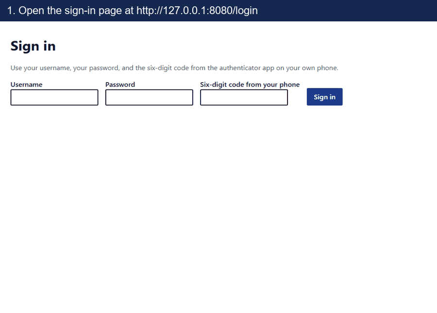

# Disaster Response Coordination

> Decision support for an emergency dispatcher: field reports go in, the system proposes which responder unit to send and how sure it is, and a person approves, modifies or rejects the proposal.

**Status:** Working on one machine over plain `http://127.0.0.1`, with a local SQLite database. Not working yet: a real notification channel (approving records a database row, DEF-017), HTTPS, a map, team-size simulation and a report generator. Open defects are listed in `docs/defect-log.md`.
**Built by:** Dranzer Rogue, solo senior capstone, CSC 4950, Fall 2026.

## 1. What this is and who it is for

A dispatcher gets incident reports (a place, what happened, a time). The software classifies the severity and the kind of responder needed, proposes one available unit with a confidence from 0 to 100, and holds the unit for 4 minutes while a person decides. It is for a dispatcher or a student evaluating the design (the full specification is `docs/requirements.md`); it replaces working out the same thing by hand from a list of reports.

**What it does not do:** it does not contact real responders (approving only records a row); it does not run over the internet or HTTPS (it listens on `127.0.0.1` only); it does not support several stations at once (one SQLite file, one machine; the move to MongoDB is a direction in ADR 0010, not built); anything graded Severe or Critical always waits for a person.

## 2. Demo



The animation above (`docs/demo/signin-and-approve.gif`) shows the current flow: sign in with a password and a phone code, then approve a waiting proposal. The same steps are written out in section 6, so nothing depends on the picture. `python tools/make_demo_gif.py` re-records it (optional; it needs Playwright, see the top of that file). A recording of the first increment, before the sign-in existed, is in `docs/demo/iteration-1-demo.mp4`.

## 3. Prerequisites

| Requirement | Version built and tested on | Check it with | What breaks without it |
|---|---|---|---|
| Python | 3.11.8 (CI also runs 3.12) | `python3 --version` prints `Python 3.11.8` | `./script/setup` cannot create the virtual environment |
| Git, including Git Bash on Windows | Git 2.46.0.windows.1, bash 5.2.26 | `git --version` and `bash --version` | the repository cannot be cloned and the `./script/*` commands (bash scripts) cannot run |
| An authenticator app on a phone | any app that takes time-based codes (Duo Mobile's third-party account option works) | n/a | you cannot sign in: the sign-in needs a six-digit code |
| Ollama (optional) | 0.40.16 | `ollama --version` | nothing: without it reports are classified by the rules-based stand-in |

On Windows, run every `./script/...` command from **Git Bash**, not PowerShell or Command Prompt.

## 4. Install

```
git clone https://github.com/DranzerZERogue56/disaster-response-coordination.git
cd disaster-response-coordination
./script/setup
```

Expected: `./script/setup` ends with `migrate.py: 9 migration(s) applied, database at data/dev.sqlite` and then `setup complete`. pip may also print a `[notice] A new release of pip is available` line; that is harmless. It took about 1 to 2 minutes on the machine that recorded `docs/evidence/m13-command-outputs.md`.

**Shortcut:** `./script/bootstrap` runs setup, seed and the account step below in one go (`./script/bootstrap --start` also starts the app). It prints the one-time password and phone key once. It ends with `bootstrap complete`.

## 5. Configure

Nothing has to be configured to run the demo: `./script/start` fills in sensible defaults. To override them, copy `.env.example` to `.env` and edit it (never commit `.env`).

| Variable | Required? | What it is | Default |
|---|---|---|---|
| `DB_PATH` | no | the SQLite file | `data/dev.sqlite` |
| `AUTH_ENFORCED` | no | `1` = every page and action except `/healthz` and `/login` needs a two-factor sign-in | `1` through `./script/start` |
| `SESSION_SIGNER` | no | key that signs the session cookie; unset gives a new random one each start, so sessions end on restart | random |
| `ALLOWED_HOSTS` | no | extra host names the app answers to, comma separated (only `localhost` and `127.0.0.1` otherwise) | none |
| `OLLAMA_ENABLED` | no | `1` uses a local model as the first tier | `0` |
| `OLLAMA_URL`, `OLLAMA_MODEL`, `OLLAMA_TIMEOUT` | no | where the model server is (this machine only), which model (`qwen3:1.7b`), seconds to wait (60) | see `.env.example` |
| `SWEEP_SECONDS`, `PURGE_CHECK_SECONDS` | no | how often held units are released (1) and old data purged (3600) | set by `./script/start` |

## 6. Run

```
./script/seed
python tools/enrol_dispatcher.py demo-dispatcher dispatcher
./script/start
```

`./script/seed` ends with `seed complete`. `enrol_dispatcher.py` prints `Account ready: demo-dispatcher (dispatcher) in data/dev.sqlite` and then a **one-time password and a phone setup key, shown once**: write them down. Type the setup key into the authenticator app on your phone. `./script/start` keeps running in that terminal and serves `http://127.0.0.1:8080`.

**Verify it actually works** (about five minutes):

1. In a second Git Bash window, in the same folder, check the app is alive: `curl http://127.0.0.1:8080/healthz` prints `{"status":"ok"}`.
2. Open `http://127.0.0.1:8080/login` in a browser and sign in as `demo-dispatcher` with the password and the six-digit code from the phone.
3. In the second window run `python tools/add_demo_proposal.py`. It prints `Proposal 1 is waiting for a person (unit 1 is held for it).` (the number may differ).
4. Reload `http://127.0.0.1:8080/dispatcher`. The proposal is listed under "Proposals waiting for a decision".
5. Press the **Approve** button on it **within 4 minutes**, or the unit is released and the proposal times out (run step 3 again for a fresh one). The page shows `Proposal 1 approved; unit 1 notified.`, the proposal leaves the waiting list and the unit shows as assigned.

Stop the app with Ctrl+C in the window where `./script/start` runs.

## 7. Test

```
./script/test
```

Expected on the latest run (2026-11-22): `831 passed`, `Total coverage: 96.19%` and `Required test coverage of 90% reached`, in about 7 minutes (the count grows as tests are added; the earlier recorded capture run showed 820). The command fails if line coverage of `src/` drops below 90%. Other checks CI runs: `./script/lint` prints `All checks passed!`, `./script/secrets-check` prints `secrets check: 0 matches across N tracked files`, `./script/build` prints `build ok`, `./script/smoke` ends with `smoke: all checks passed`. Known failing or skipped tests: none.

## 8. Project layout

```
src/            the application: web_ui (Flask routes, console, sign-in), intake_gateway, classify_propose (model chain),
                decide_proposal (safety rule), unit_registry (reserve, 4-minute clock), negotiation, notify_responder,
                override_assignment, auth, heartbeat, purge, scenario, data (repositories)
migrations/     numbered SQL files that build the database, including its triggers
seed/           the demo data (iteration-1.sql) and scenario files
script/         setup, seed, start, lint, test, build, smoke, secrets-check, seed-test-data (bash)
tools/          operator and course tools (enrol_dispatcher.py, add_demo_proposal.py, migrate.py, measurements)
tests/          unit, integration, acceptance, data (three families of test data) and manual scripts
docs/           specification, architecture, runbook, onboarding, decision records, defect log, audits
```

## 9. Troubleshooting

| Symptom | Likely cause | Fix |
|---|---|---|
| `./script/smoke` prints a Python traceback ending in `sqlite3.OperationalError: unable to open database file` | the smoke check breaks the database on purpose to prove `/healthz` reports failure | nothing: it is correct if the last lines are `smoke: /healthz correctly fails when the data store is unavailable (500)` and `smoke: all checks passed` |
| `Sign-in failed. Check the username, password and code, or try again later.` | wrong password or code, a code already used, or the account is locked for 300 seconds after 5 failures | wait for a fresh code, retry; run `python tools/enrol_dispatcher.py demo-dispatcher dispatcher` to reset the account |
| HTTP 401 from `/dispatcher` or any route while signed out | the sign-in is on and you have no session | sign in at `/login` |
| HTTP 401 from `POST /reports`, the scenario tool or heartbeats | the sign-in refuses callers with no account (DEF-032, open) | run the demo with `AUTH_ENFORCED=0 ./script/start` |
| HTTP 400 on every request from a browser or tool | the Host name is not `localhost` or `127.0.0.1` (DEF-036) | use `http://127.0.0.1:8080`, or set `ALLOWED_HOSTS` |
| HTTP 413 | the request body is over 1 MiB (DEF-038) | send a smaller body |
| The proposal vanished before you pressed Approve | the 4-minute hold ended and the unit was released | `python tools/add_demo_proposal.py` for a new one |

## 10. License

MIT, see `LICENSE`.

## 11. Contact and further reading

Open an issue at https://github.com/DranzerZERogue56/disaster-response-coordination. Architecture: `docs/architecture.md` (start with section 0) · Operations: `docs/runbook.md` · Decisions: `docs/adr/README.md` · New here? `docs/onboarding.md` · Defects: `docs/defect-log.md` · Security reviews: `docs/security-review.md` · CI: `docs/ci-pipeline.md` · Test results: `docs/test-results.md` · Clean-machine test: `docs/clean-machine-test.md` · AI usage: `docs/ai-usage.md` · The original project description: `PROJECT.md`; weekly schedule `CALENDAR.md`.
