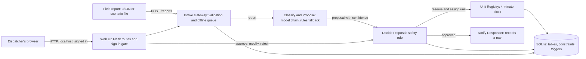
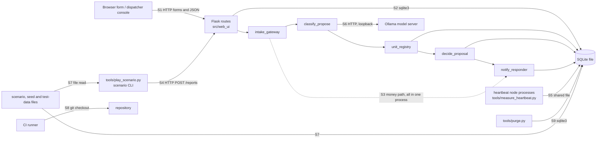

# Technical Specification — Disaster Response Coordination

Version: v0.1   Date: 2026-09-30   Author: Dranzer Rogue   Status: Draft
Requirements baseline this design satisfies: `docs/requirements.md` v1.2

## 0. Overview (read this first)

*Written 2026-11-22 from the code in this repository, for a reader who has never seen the project. The numbered sections below are the full design; where they differ from the built system, this overview and the code are right, and the differences are listed in `docs/baseline.md` and `CHANGELOG.md`.*



**What it is.** Decision support for an emergency dispatcher. A report comes in (a place, what happened, a time); the system classifies how serious it is and what kind of responder is needed, proposes one available unit with a confidence from 0 to 100, and a person approves, modifies or rejects the proposal on the dispatcher console. It runs on one machine, over plain `http://127.0.0.1`, with a local database file and no outside network calls.

**How a report travels.** The Intake Gateway checks the report and stamps it in UTC; if the connection is marked down it queues the report and drains the queue on reconnection. Classify and Propose asks a chain of models in order (a local Ollama model if enabled, an optional smaller one, then a rules-based stand-in that is always there), so a slow or broken model degrades to the next tier instead of failing the report. Decide Proposal then applies the safety rule: a person must decide whenever the confidence is below the bar (75 for the rules tier; 85 by default for a real model, never less than 75) **or the severity is Severe or Critical, whatever the confidence**. Only a proposal that clears both may be approved without a person.

**What a unit goes through.** Proposing a unit reserves it. A reserved unit is released after 4 minutes if nobody decides (a sweeper checks every second), and released at once on a rejection. An approved proposal assigns the unit and records a notification row; nothing is sent to a real responder yet (DEF-017). Incident data is purged 24 hours after it was received.

**Who may do what.** Every page and action except `/healthz` and `/login` needs a signed-in dispatcher: a password plus a six-digit code from the person's own phone (ADR 0008), and every form carries a forgery token. A person decides through the console or the JSON routes; overrides and follow-ups are appended to logs and cannot be edited.

**The part that would surprise you.** The safety rules live in the database, not only in the Python. SQLite triggers refuse to mark a unit assigned unless its proposal is approved (both on insert and on update), refuse to un-approve a proposal while its unit is assigned, and refuse to edit or delete the override, tiebreak, reconciliation and sign-in logs; CHECK constraints and foreign keys back them up. So a bug in the application, or a second program writing to the same file, still cannot double-book a unit or rewrite history; it gets an error. The cost is that moving to another data store (ADR 0010 chooses MongoDB as the direction) means re-creating each of these rules by hand as code and validators, one test at a time (backlog B-17).

## 1. Purpose and Scope

This document is the blueprint for the system described in `docs/requirements.md`: a tool that takes a disaster scenario, works out which responder types it needs, runs several candidate team sizes against a simulated version of that scenario with agents negotiating assignments in plain language, and writes up whichever team size performed best as a response plan a dispatcher could keep on file. It runs in two modes that share the same simulation and negotiation core: **batch mode**, which runs the team-size competition unattended (used for the graded evaluation runs in `PROJECT.md`'s Roster Competition), and **interactive mode**, a single live, slowed-down playback used for the capstone defense demo, where a real human dispatcher reviews and can override the agents' decisions through a web UI. The two modes exist because of a real conflict between two already-written documents: `PROJECT.md` calls for 5-10 unattended runs per team size (no human could plausibly sit through all of them), while `docs/requirements.md`'s FR-AGENT-03 requires a human to approve any low-confidence or high-severity proposal. Batch mode resolves this with a documented, logged stand-in auto-decide policy instead of a real human (see §5, Approval Gateway interface, and the Dependency Specification in §9 for why this is not "pretending a human approved it").

**In scope** (every requirement identifier below is satisfied by this design; see §10 for the full trace):
FR-INTAKE-01, FR-INTAKE-02, FR-INTAKE-03, FR-AGENT-01, FR-AGENT-02, FR-AGENT-03, FR-AGENT-04, FR-COORD-01, FR-COORD-02, FR-COORD-03, FR-RES-01, FR-RES-02, FR-RES-03, FR-DEGRADE-01, FR-DEGRADE-02, FR-DEGRADE-03, FR-DEGRADE-04, FR-INFER-01, FR-INFER-02, FR-INFER-03, FR-INFER-04, FR-ALERT-01, FR-ALERT-02, FR-MAP-01, FR-AUDIT-01, FR-AUDIT-02, FR-AUTH-01, FR-SIM-01, NFR-PERF-01, NFR-REL-01, NFR-REL-02, NFR-REL-03, NFR-REL-04, NFR-SEC-01, NFR-SEC-02, NFR-SEC-03, NFR-SEC-04, NFR-PRIV-01, NFR-ACC-01, NFR-ACC-02, NFR-USE-01, NFR-MNT-01.

**Out of scope, this design** (both are Could-priority in `docs/requirements.md` and are not built this release):
- **FR-COORD-04** (cross-agent consensus timeout) — the negotiation coordinator in §5 does not implement a 5-minute consensus fallback in v0.1; every scenario in this design's scope is small enough (a handful of team members per run) that a real consensus-timeout case has not been observed. Revisit if a walking-skeleton run (Week 9) actually stalls without one.
- **FR-MAP-02** (unit position tracking) — no live location feed exists or is planned (see ADR 0004, synthetic location graph); the dashboard shows zone boundaries (FR-MAP-01) but not moving units.
- **NFR-PORT-01** (portability) — already marked out of scope in `docs/requirements.md` §6.8; restated here because every requirement identifier in the baseline is required to appear in this document (`tools/spec-check.py`'s traceability check). This design is local-only, tied to one GPU host, and does not target multiple browsers or operating systems.

## 2. System Context (Level 1)

Diagram: [`docs/diagrams/context.dot`](diagrams/context.dot) + [`context.png`](diagrams/context.png)

| External actor / system | What it does with us | Protocol | If it is unavailable |
|---|---|---|---|
| Operator / student | Launches a batch competition run or the interactive demo | CLI (local process invocation) | Nothing runs; no degraded mode needed, this is the thing starting the system |
| Dispatcher (human) | Reviews and approves, modifies, rejects, or overrides an escalated proposal — interactive mode only | HTTP over localhost (the Web UI) | Interactive mode cannot proceed past an escalated proposal; batch mode is unaffected since it never needs a real human (see §5 Approval Gateway) |
| Scripted / typed scenario | Supplies incident reports — either a prewritten scripted sequence (FR-SIM-01) or plain-English text typed live for a demo | Intake API (FR-INTAKE-01), in-process for the scripted case | No reports arrive; the run produces nothing, logged as an empty run rather than a crash |
| Ollama (local LLM runtime) | Serves every classification, proposal-generation, and scenario-parsing call for the model `llama3.2:3b` | Local process call (Ollama's own local API, not a network host) | LLM Client's fallback chain engages: smaller local model, then a rules-based workflow, then a manual workflow (FR-DEGRADE-02) |

**Not shown, deliberately:** OSMnx / the Overpass API. ADR 0004 deferred real-street routing to a synthetic location graph for the MVP, so there is no live network call anywhere in the system boundary above — this is itself one of the facts NFR-SEC-01's connection-log test verifies.

## 3. Containers (Level 2)

Diagram: [`docs/diagrams/containers.dot`](diagrams/containers.dot) + [`containers.png`](diagrams/containers.png)

| Container | Responsibility (one sentence) | Technology | Runs where | Holds secrets? |
|---|---|---|---|---|
| Simulation & Negotiation Engine | Runs the multi-agent contract-net negotiation and the scripted/typed scenario playback, in both batch-scoring mode and interactive demo mode | Python 3.x, Mesa 3.5.1 (ADR 0003) | Operator's own machine, one process | No |
| Dispatcher Web UI | Serves the interactive-mode approve/modify/reject/override console to a human dispatcher | Python, Flask + plain HTML/JS, localhost only | Operator's own machine, interactive mode only | No (holds a session, not a secret key) |
| SQLite database | Stores every persisted entity — reports, proposals, audit trail, overrides, unit status, accounts — in one file | SQLite (public domain, ADR 0002) | Operator's own machine, one file, owner-only permissions | The single admin account's password hash (not a network secret) |
| Ollama | Loads and serves `llama3.2:3b` for every reasoning call | Ollama (MIT), model `llama3.2:3b` (ADR 0001) | Operator's own machine, separate local process | No |

**Trust boundary:** every container above runs on the operator's own machine. Nothing crosses out to a hosted or cloud service in the shipped MVP (FR-INFER-01, NFR-SEC-01, CON-03) — there is no API key anywhere in this system. The dispatcher's browser talks to the Web UI over `localhost` only; the Web UI and the Engine talk to each other over `localhost` only; nothing here is exposed to a real network interface.

## 4. Components (Level 3 — Simulation & Negotiation Engine)

Diagram: [`docs/diagrams/engine-components.dot`](diagrams/engine-components.dot) + [`engine-components.png`](diagrams/engine-components.png)

Chosen because this is the container where the hard part lives: the negotiation protocol, the confidence-threshold branch between batch and interactive mode, and the tiebreak logic.

| Component | Responsibility (verb first) | Owns (state) | Depends on | Serves (req IDs) |
|---|---|---|---|---|
| Scenario Reader | Translates a scripted or typed plain-English scenario into structured simulation settings | Nothing persisted (transient parse, held for the run) | LLM Client | FR-SIM-01 |
| Intake Gateway | Validates and queues incoming incident reports, rejects malformed ones, flags likely duplicates | The local offline queue (buffer awaiting reconnection) | Resource Agents | FR-INTAKE-01, FR-INTAKE-02, FR-INTAKE-03 |
| Resource Agents (Medical / Fire / Shelter / Security) | Classifies a report's severity and generates a proposed assignment with a confidence score and reasoning | Nothing persisted directly (writes through Audit Logger) | LLM Client, Negotiation Coordinator, Resource/Unit Registry | FR-AGENT-01, FR-AGENT-02, FR-AGENT-04 |
| Incident-Command Role | Sets the active run's negotiation ground rules; supplies the plain-language rationale the final report is built from | The run's ground-rules/policy (transient, run-scoped) | LLM Client, Negotiation Coordinator | Supports FR-COORD and report generation (PROJECT.md architecture; not itself a numbered requirement) |
| Negotiation Coordinator | Resolves conflicting proposals via announce-bid-award and the severity/richness/reported-first tiebreak | In-flight proposal/conflict state, consensus timers (transient, run-scoped) | Resource/Unit Registry, Audit Logger, Approval Gateway | FR-COORD-01, FR-COORD-02, FR-COORD-03 |
| Approval Gateway | Decides, per proposal, whether it auto-proceeds, gets the batch-mode stand-in policy, or escalates to a real human | The stand-in auto-decide policy configuration | Audit Logger; Dispatcher Web UI (interactive mode, cross-container) | FR-AGENT-03, NFR-SEC-02 |
| Resource/Unit Registry | Tracks every unit's availability and reservation state, and every agent node's heartbeat/liveness | The units table (status, reservation timestamps, node heartbeat) | Audit Logger, Notification Dispatcher | FR-RES-01, FR-RES-03, FR-DEGRADE-01 |
| Audit Logger | Logs every proposal (with the data used and confidence score) at generation time, and every dispatcher override, append-only | The audit_log and override_log tables | — (leaf) | FR-AUDIT-01, FR-AUDIT-02, FR-INFER-04, FR-AUTH-01 (the append-only log itself) |
| Notification Dispatcher | Notifies assigned responders and tracks acknowledgment | The notifications table | Audit Logger | FR-ALERT-01, FR-ALERT-02 |
| Roster Competition Runner | Orchestrates repeated batch runs across candidate team sizes and scenarios, scores each run | The scenario_runs/scores table | Scenario Reader, Resource Agents, Report & Visualization Generator | PROJECT.md's Roster Competition + Evaluation sections; operationally serves FR-SIM-01 |
| Report & Visualization Generator | Reads a finished run's logs and renders the Markdown report plus a static post-run image | Nothing persisted (writes generated files to `reports/`) | Audit Logger (read), Resource/Unit Registry (read) | FR-MAP-01 (rendered, not live), PROJECT.md Report generation |
| LLM Client | Wraps every Ollama call behind one shared interface; enforces local-only, the model-load fallback chain, the hardware check, and records which model/version served each call | Nothing persisted directly (writes model-version facts through Audit Logger) | Ollama (separate container) | FR-INFER-01, FR-INFER-02, FR-INFER-03, FR-INFER-04, FR-DEGRADE-02 |

**Dependency graph is acyclic: yes.** Everything bottoms out at Audit Logger or LLM Client, neither of which calls back upward into any other component in this list. Approval Gateway's one cross-container edge (to the Dispatcher Web UI, interactive mode only) doesn't create a cycle either — the Web UI never calls back into Approval Gateway's internal state, it only submits a decision through the same interface a batch-mode stand-in decision would use (see §5).

**Every piece of state has exactly one owner: yes.** No two components above claim the same table or the same transient state; see the "Owns" column — each row is unique.

## 5. Interface Contracts

One block per interface serving a Must-priority requirement. Eight facts each. Interfaces 1, 3, and 4 are the Web UI's real HTTP surface (localhost only); the rest are internal Python call contracts between components in the same process — still specified with the same eight facts, since an internal boundary is still a contract a stranger has to be able to implement against.

### Submit Incident Report                         (serves FR-INTAKE-01, FR-INTAKE-02, FR-INTAKE-03)
Purpose      Accept one incident report — from a simulated field agent, or from the Scenario Reader's scripted playback — validate it, and create or queue it
Auth         None (intake is unauthenticated; FR-AUTH-01's role model governs dispatcher actions, not report intake)
Request      `location` string required; `severity_raw` string required (free text, classified later by Classify & Propose); `timestamp` ISO 8601 UTC required; `reporting_unit` string required; `description` string optional
Success      `{report_id: int, status: "created"|"queued", received_at: ISO 8601 UTC}`
Errors       `FIELD_MISSING` — every missing field listed together, not one at a time (FR-INTAKE-02); `FIELD_INVALID` — a present field fails its format rule (e.g. timestamp not ISO 8601), also listed together with any `FIELD_MISSING` hits in one response
Idempotency  Not idempotent by a caller-supplied ID. Two reports within 1 block and 10 minutes with a matching address or corroborating description are instead flagged a probable duplicate and merged for accuracy (FR-INTAKE-03), not rejected
Side effects Writes a row to `incident_reports` (or the offline queue, if the connectivity flag is down); on creation, triggers Classify & Propose for that report
Limits       The offline queue drains in timestamp order on reconnection, oldest first, so a reconnection burst can't overwhelm the system at once (FR-INTAKE-01); the queue has no fixed maximum size in this release — open question OQ-1 (§11)

### Classify & Propose                              (serves FR-AGENT-01, FR-AGENT-02, FR-AGENT-04)
Purpose      Classify a created report's severity and generate a resource-assignment proposal with a confidence score, reasoning, and alternatives
Auth         Internal call only; invoked by Intake Gateway on report creation
Request      `{report_id: int, report_fields: object}`
Success      `{severity: Minor|Moderate|Serious|Severe|Critical, confidence: int 0-100, recommended_unit_id: int, reasoning: string, alternatives: [unit_id]}`
Errors       `CLASSIFICATION_UNCERTAIN` — the model can't confidently pick a severity; escalates to a human directly instead of guessing (FR-AGENT-01); `REASONING_TIMEOUT` — exceeded the ~60s budget, falls back to a non-LLM path and reports to the human overseer (FR-AGENT-04)
Idempotency  Not idempotent — a repeat call for the same `report_id` produces a new, independently-reasoned proposal (the model isn't guaranteed deterministic), logged separately
Side effects Writes the proposal through Log Decision *before* any approval decision exists (FR-AUDIT-01); reserves the recommended unit through the Resource/Unit Registry at the moment the proposal is made (FR-RES-03)
Limits       One in-flight classification per `report_id`; a second concurrent call for the same report returns `ALREADY_IN_PROGRESS`

### Decide Proposal                                 (serves FR-AGENT-03, NFR-SEC-02)
Purpose      Resolve whether a proposal proceeds automatically, through the batch-mode stand-in policy, or through a real dispatcher's decision — one interface, two callers
Auth         Batch mode: none, internal call from Roster Competition Runner. Interactive mode: a dispatcher-role session (FR-AUTH-01); an observer-role session may view the pending queue but calling this interface's approve/modify/reject actions is blocked and logged
Request      `{proposal_id: int, decision: "approve"|"modify"|"reject", modified_unit_id: int (required if decision=modify), decided_by: "stand-in-policy"|dispatcher_account_id}`
Success      `{proposal_id: int, final_status: "approved"|"modified"|"rejected", decided_at: ISO 8601 UTC}`
Errors       `BELOW_THRESHOLD_NO_DECIDER` — confidence under 75 or severity Severe/Critical, and no decider is configured for this run (a configuration error, not a normal path); `UNIT_NO_LONGER_AVAILABLE` — the named unit was reserved by another proposal first, triggers FR-RES-01's secondary follow-up
Idempotency  A second call on an already-decided `proposal_id` returns the existing decision unchanged (`ALREADY_DECIDED`) rather than deciding twice
Side effects Proposals with confidence ≥ 75 **and** severity not Severe/Critical never reach this interface — they auto-proceed straight to Reserve Unit (NFR-SEC-02). Everything else routes here. In batch mode, the stand-in policy approves at confidence ≥ 60 and otherwise logs the proposal as `UNRESOLVED_WOULD_ESCALATE`, scored accordingly rather than blocking the run — a deliberate, disclosed approximation of a human, recorded in ADR 0006, never silently presented as a real approval. Every stand-in decision is logged with `decided_by: "stand-in-policy"` so it's never confused with a dispatcher's decision in the audit trail
Limits       Interactive mode targets a dispatcher decision within 45s of the proposal appearing in the Web UI (NFR-USE-01) — a usability target measured by observation, not a server-enforced timeout

### Override Assignment                             (serves FR-RES-02, FR-AUDIT-02)
Purpose      Let a dispatcher replace any system-generated assignment, at any time, with a reason
Auth         Dispatcher-role session required; an observer-role session is blocked and the attempt is logged (FR-AUTH-01)
Request      `{assignment_id: int, new_unit_id: int, reason: string (required, non-empty)}`
Success      `{assignment_id: int, override_id: int, status: "overridden", logged_at: ISO 8601 UTC}`
Errors       `REASON_REQUIRED` — rejected outright until a reason is supplied (FR-RES-02); `ASSIGNMENT_NOT_FOUND`
Idempotency  Not idempotent — every call creates a new `override_log` row, even repeating the same `new_unit_id`; each is its own decision worth its own record
Side effects Logs who, when, why, the original agent choice, and the elapsed time between AI escalation and human approval (FR-RES-02); takes effect immediately, then opens an unlimited follow-up window where the dispatcher may add to the same log entry without blocking the original decision
Limits       None specified; a dispatcher may override the same assignment any number of times

### Resource/Unit Registry                          (serves FR-RES-01, FR-RES-03, FR-DEGRADE-01)
Purpose      Track every unit's availability/reservation state, and detect a silent agent node
Operations   `reserve(unit_id, incident_id)`, `release(unit_id)`, `get_status(unit_id)`, `heartbeat(node_id)`
Auth         Internal call only
Request      `reserve`: `{unit_id: int, incident_id: int, reserved_by: proposal_id}`. `heartbeat`: `{node_id: string, timestamp: ISO 8601 UTC}`
Success      `reserve` → `{unit_id: int, status: "reserved", reserved_at: timestamp}`; `heartbeat` → `{node_id: string, status: "alive"}`
Errors       `UNIT_ALREADY_RESERVED` — another proposal reserved it first; the caller proposes the next-best available unit instead (FR-COORD-01); `NODE_NOT_RESPONDING` — raised by the registry's own poll, not the node, once 30s pass with no heartbeat (FR-DEGRADE-01)
Idempotency  `release` on an already-available unit is a no-op returning current state, not an error. `reserve` on an already-reserved unit always fails — this is the exact mechanism FR-RES-03 relies on to prevent double-booking
Side effects Every status change (reserve, release, node-down, node-recovered) is pushed to every other agent, and cached if delivery fails (FR-RES-03). A released reservation returns to available within 4 minutes (NFR-REL-02). A recovered node is marked recovered and requires a human to confirm the interruption didn't affect any information before its data is trusted again (FR-DEGRADE-01)
Limits       Heartbeat checked every 10s; 3 consecutive misses (30s) trips `NODE_NOT_RESPONDING`

### Resolve Negotiation Conflict                    (serves FR-COORD-01, FR-COORD-02, FR-COORD-03)
Purpose      Apply the one tiebreak rule — severity, then information richness, then reported-first — whenever two agent proposals can't both be satisfied
Auth         Internal call only
Request      `{proposal_a: proposal_id, proposal_b: proposal_id}`
Success      `{winner: proposal_id, loser: proposal_id, reason: "severity"|"richness"|"reported-first", resolved_at: timestamp}`
Errors       `TRUE_TIE` — identical across all three dimensions; both proposals are validated, one proceeds, the other is kept as history rather than discarded (FR-COORD-03)
Idempotency  Resolving the same pair twice returns the same winner deterministically — the tiebreak is a pure function of already-logged data that doesn't change afterward
Side effects The losing agent finds and proposes the next-best available unit (FR-COORD-01). If the conflict was two agents' different pictures of the same incident rather than a unit claim, the newer-timestamped data becomes the active record unless a human overrides it — logged the same way as an Override Assignment call (FR-COORD-02)
Limits       None specified

### Log Decision                                    (serves FR-AUDIT-01, FR-AUDIT-02, FR-INFER-04, FR-AUTH-01)
Purpose      Record every agent proposal and every dispatcher override, append-only — the log reflects what was actually reasoned and decided, never edited after the fact
Operations   `log_proposal(...)`, `log_override(...)`, `get_entries(filter)`
Auth         Internal `log_*` calls from any component; `get_entries` requires a dispatcher or admin session
Request      `log_proposal`: `{report_id, severity, confidence, recommended_unit_id, reasoning, model_identifier, model_version, generated_at}` — this is where FR-INFER-04's model-version pinning is recorded
Success      `{entry_id: int, logged_at: timestamp}`
Errors       `WRITE_FAILED` — always surfaced to the human overseer, never silently retried, since a missing audit entry defeats the explainability requirement this interface exists for
Idempotency  Every call creates a new row; there is no update or delete operation on this interface — only `put` (create) and `get` (read) exist, by design (FR-AUTH-01: "no one, including the admin, can delete entries")
Side effects None beyond the write itself
Limits       No cap on entry count inside the 24-hour retention window (NFR-PRIV-01); the scheduled purge job, not this interface, removes rows after 24 hours

### LLM Generate                                    (serves FR-INFER-01, FR-INFER-02, FR-DEGRADE-02)
Purpose      The one shared interface every reasoning call goes through — classification, proposal generation, scenario parsing — wrapping Ollama and the local-only guarantee. Full budget/fallback/verification detail is in §9; this entry is the calling contract only
Auth         Internal call only
Request      `{prompt: string, output_schema: JSON schema, caller: component name}`
Success      `{output: object validated against output_schema, model_identifier: "llama3.2:3b", latency_ms: int}`
Errors       `SCHEMA_VALIDATION_FAILED` — one retry with the schema restated in the prompt, then falls through to FR-DEGRADE-02's fallback chain; `TIMEOUT` — exceeded ~60s (FR-AGENT-04); `MODEL_UNAVAILABLE` — Ollama process unreachable
Idempotency  Not idempotent — model output is not guaranteed identical between calls; every call is its own reasoning attempt
Side effects Never makes an outbound call to any host outside the local machine, even if one is reachable — enforced in code, not just configuration (FR-INFER-01), and what NFR-SEC-01's connection-log test checks for
Limits       One concurrent call per caller; the ~60s timeout is per call, not cumulative

### Play Scenario                                   (serves FR-SIM-01)
Purpose      Replay a prewritten incident sequence at a controlled pace, on demand, so the same scenario runs reliably for a batch run or the capstone defense
Auth         Internal call, invoked by the Operator via CLI (batch mode) or the interactive-mode launcher
Request      `{scenario_file: path, pace: "scripted"|"live-typed", speed_multiplier: float}`
Success      `{run_id: int, reports_queued: int, started_at: timestamp}`
Errors       `SCENARIO_FILE_INVALID` — malformed scenario file, fails before any report reaches Submit Incident Report
Idempotency  Each call starts a new, independently-numbered run; replaying the same file twice yields two separate `run_id`s by design — exact repeatability is the point, not deduplication
Side effects Feeds every report in the sequence through Submit Incident Report at the scenario's defined pace
Limits       None specified

### Notify Responder                                (serves FR-ALERT-01)
Purpose      Notify the unit assigned to an incident once the assignment is finalized
Auth         Internal call only
Request      `{assignment_id: int, unit_id: int}`
Success      `{notification_id: int, sent_at: timestamp}`
Errors       `UNIT_UNREACHABLE` — no acknowledgment channel is configured for this unit in this release (open question OQ-2, §11 — FR-ALERT-01 doesn't specify the actual channel)
Idempotency  Re-notifying the same `assignment_id` creates a new notification row rather than suppressing the repeat — a dispatcher should be able to see a double notification if one happened
Side effects None beyond the notification record. Acknowledgment tracking (FR-ALERT-02, Should-priority) isn't implemented by this interface in v0.1; `notifications` reserves a nullable `acknowledged_at` column for it (§6)
Limits       None specified

### Purge Job                                       (serves NFR-PRIV-01)
Purpose      Delete every row 24 hours past its retention clock (`received_at` for reports, `generated_at` for proposals, and the same window for overrides/units/nodes/notifications), except `dispatcher_accounts` and `scenario_runs`, which are the two deliberate exceptions named in §6
Auth         Internal only; runs on a schedule, not callable by a dispatcher or the Web UI
Request      `{retention_hours: int, now_override: timestamp (test-only, lets a test skip waiting 24h)}`
Success      `{purged: {incident_reports: int, agent_proposals: int, dispatcher_overrides: int, units: int, agent_nodes: int, notifications: int}, run_at: timestamp}`
Errors       `PURGE_FAILED` — surfaced the same way `WRITE_FAILED` is (never silently retried); a failed purge is a privacy-relevant failure, not an ordinary one
Idempotency  Running it twice in immediate succession is safe — the second run finds nothing past the retention clock and reports zero rows purged for every table
Side effects Hard-deletes rows (not a soft-delete flag) — this is what NFR-PRIV-01's own measurement method requires: "query every data store for the seeded report IDs and expect zero rows," which a flag alone wouldn't satisfy Implementation note (CR-009): units are reset to available rather than deleted, because they are the resources and not incident data; agent nodes hold no incident data and are left alone; the success shape is `{purged: {incident_reports, agent_proposals, dispatcher_overrides, override_follow_ups, notifications}, reset: {units}, run_at}`.
Limits       Runs once per hour in practice (fine against a 24-hour window); the exact schedule isn't pinned to a specific cron expression in this release — see Open Question OQ-3, since this is the interface that makes that question concrete

Error envelope used system-wide:
```json
{
  "error": {
    "code": "ONE_OF_THE_CODES_NAMED_ABOVE",
    "message": "human-readable, specific to this call",
    "field": "set only for a per-field validation error, otherwise absent",
    "retryable": false
  }
}
```
Every error code named in the ten interfaces above fits this one shape; no interface invents its own error format.

Status-code policy (the Web UI's HTTP surface only — Submit Incident Report, Decide Proposal's interactive path, and Override Assignment; every other interface above is an internal Python call that raises an exception carrying the same `code` field, not an HTTP status):

| Code | Meaning in this system |
|---|---|
| 200 | Success |
| 400 | `FIELD_MISSING` / `FIELD_INVALID` / `REASON_REQUIRED` |
| 401 | No valid dispatcher session |
| 403 | Session valid but the role forbids this action (FR-AUTH-01) |
| 404 | Referenced report/proposal/assignment/unit does not exist |
| 409 | `UNIT_ALREADY_RESERVED`, or a conflicting concurrent decision |
| 422 | Well-formed request, semantically invalid (e.g. severity outside the five defined levels) |
| 500 | `WRITE_FAILED` or any unhandled internal error — the response body never includes report content (NFR-SEC-03); detail lives only in the audit log |
| 503 | `MODEL_UNAVAILABLE` after every fallback in FR-DEGRADE-02's chain is exhausted |

## 6. Data Model

Key decisions made before writing this section (confirmed by the author, not the assistant's default): an agent **node maps to one role-type** (Medical, Fire, Shelter, Security, plus Incident-Command — five nodes per run, not one per individual unit); **integer auto-increment primary keys** throughout; **plain numbered SQL migrations with a `schema_migrations` table**, forward-only; the admin password is hashed with **`hashlib.scrypt`** (Python stdlib, no new dependency), salted, never stored in the repository (NFR-SEC-04).

**One structural simplification worth stating explicitly:** there is no separate `assignments` table. An "assignment" (FR-RES-01) is an `agent_proposals` row whose `final_status` is `approved` or `modified` — the proposal and the assignment are the same row at two points in its life, not two entities that would otherwise have to be kept in sync.

**Timestamp convention, decided once:** every timestamp column is ISO 8601 UTC, generated at write time. Local time is computed exactly once, in the Dispatcher Web UI's rendering layer, for display only — never stored.

### Entity: incident_reports                        (serves FR-INTAKE-01, FR-INTAKE-02, FR-INTAKE-03)
Purpose        One row per incident report, whether it arrived validated or is still waiting in the offline queue
| Column | Type | Null | Meaning |
|---|---|---|---|
| id | INTEGER | NOT NULL | Primary key |
| scenario_run_id | INTEGER | NOT NULL | FK scenario_runs.id — which run this report belongs to |
| location | TEXT | NOT NULL | Free-text location |
| severity_raw | TEXT | NOT NULL | The original free-text severity input, pre-classification |
| severity | TEXT | NULL | One of Minor/Moderate/Serious/Severe/Critical; NULL until Classify & Propose completes |
| timestamp_reported | TEXT | NOT NULL | ISO 8601 UTC, when the report was made |
| reporting_unit | TEXT | NOT NULL | Which simulated field unit reported it |
| description | TEXT | NULL | Optional free text |
| status | TEXT | NOT NULL | `queued` \| `created` \| `classified` \| `duplicate_merged` |
| duplicate_of_id | INTEGER | NULL | FK incident_reports.id; set only when status=`duplicate_merged` |
| received_at | TEXT | NOT NULL | ISO 8601 UTC, when the row was actually created (may be later than timestamp_reported if it was queued) |
Invariants     I1: `severity` is NULL only while status is `queued` or `created`. I2: `duplicate_of_id` is set only when status=`duplicate_merged`, and never points at a row that is itself `duplicate_merged` (merge directly to the original, no chains). I3: a `queued` row has zero `agent_proposals` referencing it — nothing reasons on unvalidated, undelivered data.
Relationships  One incident_report → many agent_proposals (0..N). One incident_report → 0 or 1 duplicate_of (self-referential). Many incident_reports → one scenario_run.
Volume         30-50 rows per run (`PROJECT.md`'s stated scenario scale) × an estimated 45-250 batch runs across the semester (3-5 team sizes × 3-5 scenarios × 5-10 repeats) = roughly 1,350-12,500 rows generated by Week 16 — not resident at once, since NFR-PRIV-01 purges each row 24h after `received_at`
Lifecycle      Created at intake (or `queued`, then `created` on reconnection); purged 24h after `received_at` (NFR-PRIV-01), regardless of whether the Report & Visualization Generator has already read it — see Open Question OQ-3 (§11)

### Entity: agent_proposals                         (serves FR-AGENT-01, FR-AGENT-02, FR-AGENT-03, FR-AUDIT-01, FR-INFER-04, FR-RES-01)
Purpose        One row per reasoning attempt; becomes the operative "assignment" once `final_status` is set to `approved` or `modified`
| Column | Type | Null | Meaning |
|---|---|---|---|
| id | INTEGER | NOT NULL | Primary key |
| report_id | INTEGER | NOT NULL | FK incident_reports.id |
| agent_node_id | INTEGER | NOT NULL | FK agent_nodes.id — which role-type node generated this |
| confidence | INTEGER | NOT NULL | 0-100 |
| recommended_unit_id | INTEGER | NOT NULL | FK units.id |
| reasoning | TEXT | NOT NULL | The agent's plain-language rationale |
| alternatives | TEXT | NOT NULL | JSON array of unit_ids — read-only, never queried relationally, so a join table would add structure with no use |
| model_identifier | TEXT | NOT NULL | e.g. `llama3.2:3b` |
| model_version | TEXT | NOT NULL | Ollama's reported version/digest (FR-INFER-04) |
| decided_by | TEXT | NULL | NULL until decided; else `auto`, `stand-in-policy`, or a dispatcher_accounts.id (as text) |
| final_status | TEXT | NULL | NULL until decided; else `approved` \| `modified` \| `rejected` \| `unresolved_would_escalate` |
| generated_at | TEXT | NOT NULL | Logged before any decision exists (FR-AUDIT-01) |
| decided_at | TEXT | NULL | Set together with final_status and decided_by, atomically |
Invariants     I1: `decided_at` is NULL if and only if `final_status` is NULL. I2: once `final_status` is set, no column on this row ever changes again — the one update that sets `final_status`/`decided_by`/`decided_at` together is the last write this row ever receives. I3: `confidence ≥ 75` and severity not Severe/Critical implies `decided_by = 'auto'` (NFR-SEC-02). I-input (added by CR-004, migration 0004): `input_data` holds a JSON snapshot of the report fields the agent read, written when the proposal is generated, and cannot be changed once written.
Relationships  Many agent_proposals → one incident_report; many → one agent_node; many → one units (as recommended_unit_id).
Volume         Roughly 1-1.5× the incident_reports count (a minority get a second reasoning attempt after a timeout or uncertain classification) — an estimated 1,500-18,000 rows generated by Week 16, same 24h purge
Lifecycle      Created once at generation; exactly one later update sets the decision; purged 24h after `generated_at` with the rest of the audit trail (NFR-PRIV-01)

### Entity: dispatcher_overrides                    (serves FR-RES-02, FR-AUDIT-02, FR-COORD-02's override path)
Purpose        One row per dispatcher override of an assignment, at any point in its life
| Column | Type | Null | Meaning |
|---|---|---|---|
| id | INTEGER | NOT NULL | Primary key |
| assignment_id | INTEGER | NOT NULL | FK agent_proposals.id — the proposal being overridden |
| dispatcher_account_id | INTEGER | NOT NULL | FK dispatcher_accounts.id |
| new_unit_id | INTEGER | NOT NULL | FK units.id |
| original_agent_choice_unit_id | INTEGER | NOT NULL | FK units.id — snapshot of what the agent had chosen, so it stays comparable even after further changes |
| reason | TEXT | NOT NULL | Required at submission time; rejected until non-empty |
| follow_up_explanation | TEXT | NULL | Added later, in the no-time-pressure window — the one documented exception to "never update a row" in this schema |
| ai_escalated_at | TEXT | NULL | When the AI requested human approval, if this override followed an escalation |
| overridden_at | TEXT | NOT NULL | |
Invariants     I1: `reason` is non-empty (app-layer check, not a bare NOT NULL, since an empty string would pass NOT NULL). I2: `ai_escalated_at ≤ overridden_at` whenever `ai_escalated_at` is not NULL. I-append-only (added by CR-002, migration 0003): follow-ups live in `override_follow_ups`, one row each; neither that table nor `dispatcher_overrides` can be edited, only added to.
Relationships  Many dispatcher_overrides → one agent_proposals; many → one dispatcher_accounts; many → one units (twice: new_unit_id and original_agent_choice_unit_id).
Volume         Expected minority of finalized proposals — estimated low hundreds across the semester's testing, same 24h purge
Lifecycle      Created once at override; `follow_up_explanation` may be added exactly once afterward; purged 24h with the rest of the audit trail

### Entity: units                                   (serves FR-RES-01, FR-RES-03)
Purpose        One row per responder unit that exists within one scenario run's team-size configuration — not a persistent real-world fleet, a simulated roster re-created per run
| Column | Type | Null | Meaning |
|---|---|---|---|
| id | INTEGER | NOT NULL | Primary key |
| scenario_run_id | INTEGER | NOT NULL | FK scenario_runs.id |
| unit_type | TEXT | NOT NULL | `Medical` \| `Fire` \| `Shelter` \| `Security` |
| agent_node_id | INTEGER | NOT NULL | FK agent_nodes.id — the role-type node managing this unit |
| status | TEXT | NOT NULL | `available` \| `reserved` \| `assigned` \| `out_of_service` |
| reserved_by_proposal_id | INTEGER | NULL | FK agent_proposals.id; set when status is `reserved` or `assigned` |
| reserved_at | TEXT | NULL | |
| released_expected_by | TEXT | NULL | `reserved_at` + 4 minutes — what NFR-REL-02's test polls against |
Invariants     I1: `status = 'available'` implies `reserved_by_proposal_id IS NULL`. I2: `status IN ('reserved','assigned')` implies `reserved_by_proposal_id IS NOT NULL`. I3: at most one unit row may carry a given `reserved_by_proposal_id` — enforced by requiring `reserve()` to check `status='available'` and write the reservation in the same transaction, which is the actual mechanism FR-RES-03 depends on to prevent double-booking. I-assigned (added by CR-001, enforced by triggers in migration 0002): `status = 'assigned'` implies the referenced proposal has `final_status` `approved` or `modified`, and that proposal cannot leave those states while the unit is assigned.
Relationships  Many units → one agent_node; many → one scenario_run; one unit → 0 or 1 agent_proposals (reserved_by, at a time).
Volume         25-40 rows per run (`PROJECT.md` scope) × 45-250 runs = roughly 1,125-10,000 rows generated by Week 16
Lifecycle      Created at run start (one row per unit in that run's configuration); status updated in place throughout the run (not append-only — this is current state, not an audit record); purged with the run's data 24h after the run's reports were received

### Entity: agent_nodes                              (serves FR-DEGRADE-01, FR-DEGRADE-02)
Purpose        One row per role-type agent process within one scenario run (Medical, Fire, Shelter, Security, Incident-Command — five per run)
| Column | Type | Null | Meaning |
|---|---|---|---|
| id | INTEGER | NOT NULL | Primary key |
| scenario_run_id | INTEGER | NOT NULL | FK scenario_runs.id |
| role_type | TEXT | NOT NULL | `Medical` \| `Fire` \| `Shelter` \| `Security` \| `IncidentCommand` |
| status | TEXT | NOT NULL | `alive` \| `not_responding` \| `recovered` |
| last_heartbeat_at | TEXT | NOT NULL | |
| recovered_confirmed_by | INTEGER | NULL | FK dispatcher_accounts.id — FR-DEGRADE-01's required human confirmation that an interruption didn't affect any information |
Invariants     I1: `status = 'not_responding'` implies more than 30 seconds have passed since `last_heartbeat_at` (the detection threshold). I2: `status = 'recovered'` implies `recovered_confirmed_by IS NOT NULL` — a node cannot be fully trusted again without the human check.
Relationships  Many agent_nodes → one scenario_run; one agent_node → many units (the ones it manages); one agent_node → many agent_proposals (the ones it generated).
Volume         5 rows per run × 45-250 runs = roughly 225-1,250 rows by Week 16 — trivial
Lifecycle      Created at run start; `status`/`last_heartbeat_at` updated in place (current state, not an audit record); purged with the run's data at 24h

### Entity: dispatcher_accounts                     (serves FR-AUTH-01)
Purpose        One row per dispatcher/admin/observer account — all fictional test identities in this release
| Column | Type | Null | Meaning |
|---|---|---|---|
| id | INTEGER | NOT NULL | Primary key |
| username | TEXT | NOT NULL | UNIQUE |
| password_hash | TEXT | NOT NULL | Argon2id encoded string (`$argon2id$v=19$m=19456,t=2,p=1$...`; the salt is inside it); hashes made before 2026-11-18 are hex scrypt and are upgraded at the next sign-in (DEF-040) |
| password_salt | TEXT | NOT NULL | Empty for Argon2id hashes (the salt is inside `password_hash`); the hex salt for old scrypt hashes until their owner next signs in |
| role | TEXT | NOT NULL | `admin` \| `dispatcher` \| `observer` — MVP populates one `admin` plus a small number of fictional `dispatcher` test accounts |
| is_fictional_test_account | INTEGER | NOT NULL | Always 1 (true) in this release (NFR-SEC-03); the column exists so a real-deployment release has somewhere to flip it |
| created_at | TEXT | NOT NULL | |
Invariants     I1: exactly one row has `role = 'admin'` (the single-admin-account decision, `docs/requirements.md` §6.4.1). I2: `is_fictional_test_account` is always 1 in this release.
Relationships  One dispatcher_account → many dispatcher_overrides; one → many agent_proposals (where decided_by names this account).
Volume         Single digits; fixed, not scenario-scoped
Lifecycle      Created once at setup; **never auto-purged** — this is account data, not incident data (`docs/requirements.md` §6.4.1: "Life of the project"); deleted only by the admin, manually

### Entity: notifications                           (serves FR-ALERT-01, FR-ALERT-02)
Purpose        One row per responder notification sent for a finalized assignment
| Column | Type | Null | Meaning |
|---|---|---|---|
| id | INTEGER | NOT NULL | Primary key |
| assignment_id | INTEGER | NOT NULL | FK agent_proposals.id |
| unit_id | INTEGER | NOT NULL | FK units.id |
| sent_at | TEXT | NOT NULL | |
| acknowledged_at | TEXT | NULL | Reserved for FR-ALERT-02 (Should-priority, not implemented in v0.1's logic — the column exists now so this isn't a schema migration later) |
Invariants     None beyond the two foreign keys.
Relationships  Many notifications → one agent_proposals; many → one units.
Volume         Roughly one per finalized assignment — same order of magnitude as `approved`/`modified` rows in agent_proposals
Lifecycle      Created once at notify time; purged with the run's data at 24h

### Entity: scenario_runs                           (serves FR-SIM-01; PROJECT.md's Roster Competition and Evaluation)
Purpose        One row per batch or interactive run — the one entity that deliberately outlives the 24h purge, since the whole point of the roster competition is comparing runs across the semester
| Column | Type | Null | Meaning |
|---|---|---|---|
| id | INTEGER | NOT NULL | Primary key |
| mode | TEXT | NOT NULL | `batch` \| `interactive` |
| scenario_file | TEXT | NOT NULL | Which scenario was played |
| team_size_config | TEXT | NOT NULL | JSON, e.g. `{"Medical":10,"Fire":8,"Shelter":5,"Security":7}` |
| started_at | TEXT | NOT NULL | |
| finished_at | TEXT | NULL | NULL while the run is in progress |
| score | REAL | NULL | The overall effectiveness score (`PROJECT.md` Evaluation); NULL until scoring completes |
| unresolved_would_escalate_count | INTEGER | NOT NULL | Default 0 — how many proposals hit the batch stand-in's unresolved path (ADR 0006's transparency requirement) |
Invariants     I1: `finished_at IS NOT NULL` implies `score IS NOT NULL` — a finished run is always scored before it's considered done.
Relationships  One scenario_run → many agent_nodes, many units, many incident_reports.
Volume         Up to roughly 250 rows across the whole semester (upper bound of 5 team sizes × 5 scenarios × 10 repeats) — trivial
Lifecycle      Created at run start; updated once at completion (score, finished_at, counts); **persists for the life of the project** — this is the one deliberate exception to the 24h purge, since the final written comparison in Week 16 needs every prior run's score, not just the raw incident data NFR-PRIV-01 is actually about

### Migrations
Mechanism      Plain numbered SQL files applied in order, tracked in a `schema_migrations(version INTEGER PRIMARY KEY, applied_at TEXT NOT NULL)` table — no migration library, consistent with this project's existing low-dependency pattern (Jinja2-or-f-strings for the report generator, no ORM)
Direction      Forward-only. A 16-week solo project with one developer and no shared staging database has little use for rollback migrations; if a migration turns out wrong, the fix is a new, higher-numbered migration, not a reverse of the old one
Path + runner  `migrations/0001-initial.sql`, applied by `tools/migrate.py <db-path>` — the runner reads every `migrations/NNNN-*.sql` file whose number isn't already in `schema_migrations`, applies it inside one transaction, and records the version
Conventions    All timestamps stored as ISO 8601 UTC text (SQLite has no native timestamp type); all IDs are integer auto-increment; enums are plain TEXT constrained by the invariants above, not a SQL CHECK constraint (SQLite's CHECK support is usable but the project's existing checkers (`tools/check_requirements.py`-style scripts) are the established pattern for enforcing structure, so enum validation happens at the Python layer, consistent with that)

## 7. Sequence Flows

### Flow 1 — The money path: a report becomes a notified, confirmed assignment     (serves FR-INTAKE-01, FR-AGENT-01, FR-AGENT-02, NFR-SEC-02, FR-RES-01, FR-RES-03, FR-ALERT-01)
Submit Incident Report → Classify & Propose (via LLM Generate) → Resource/Unit Registry.reserve() → Log Decision.log_proposal() → Decide Proposal auto-path (confidence ≥ 75, not Severe/Critical) → Resource/Unit Registry marks `assigned` → Notify Responder → Log Decision records `final_status='approved'`.

| Step | What can go wrong | System behavior | User sees |
|---|---|---|---|
| Submit report | a required field is missing | `FIELD_MISSING`, every bad field named at once (FR-INTAKE-02) | Batch: logged, scenario continues. Interactive: inline rejection naming the field |
| reserve() | a faster proposal already reserved the unit | `UNIT_ALREADY_RESERVED`; this agent proposes the next-best available unit instead (FR-COORD-01) | Nothing — resolved before any human-visible step |
| Decide Proposal | confidence lands at 74, one point under the threshold | routes to escalation instead of auto-approving (NFR-SEC-02) — see Flow 2/3's sibling, the escalation path, not re-walked here | A pending item appears in the Web UI (interactive), or the stand-in policy decides (batch, ADR 0006) |
| Notify Responder | no acknowledgment channel is configured for the unit | `UNIT_UNREACHABLE` logged; the assignment itself is unaffected, since FR-ALERT-01's job is the notification, not the acknowledgment | Nothing visible — FR-ALERT-02's ack tracking is Should-priority, not built in v0.1 |

### Flow 2 — The risky path: a reasoning call crosses into Ollama, a process we don't control the timing of     (serves FR-AGENT-01, FR-AGENT-04, FR-INFER-02, FR-DEGRADE-02)
Classify & Propose → LLM Generate → Ollama (the one real process boundary in this design) → the model responds slow or with output that fails schema validation → LLM Client retries once with the schema restated → a second failure engages FR-DEGRADE-02's fallback chain: smaller local model → rules-based workflow → manual workflow.

| Step | What can go wrong | System behavior | User sees |
|---|---|---|---|
| Ollama call | response exceeds ~60s | `TIMEOUT`; attempt abandoned, logged, falls to a non-LLM path (FR-AGENT-04) | Interactive: the proposal never appears as LLM-generated, a manual-workflow placeholder does. Batch: logged, scenario continues |
| Ollama call | output doesn't match `output_schema` | `SCHEMA_VALIDATION_FAILED`; one retry, schema restated in the prompt | Nothing, unless the retry also fails |
| retry | second schema failure | falls to the smaller "lower level" model (FR-DEGRADE-02 step 1) | Nothing in the proposal's shape — the audit log's `model_identifier` names which model actually answered |
| lower model | also fails to load | falls to the rules-based workflow (FR-DEGRADE-02 step 2) | The proposal's `reasoning` field reads as rules-based, visible in the audit log, never disguised as an LLM call |

### Flow 3 — The failure path: Flow 2 with Ollama actually down     (serves FR-DEGRADE-02, FR-AGENT-04)
Same chain as Flow 2, with the boundary fully broken instead of merely slow: Ollama isn't running, or crashes mid-session.

| Step | What can go wrong | System behavior | User sees |
|---|---|---|---|
| Ollama call | process unreachable at all | `MODEL_UNAVAILABLE`; skips straight to the fallback chain instead of waiting out the ~60s timeout | Flow 2's fallback path, triggered immediately rather than after a wait |
| lower model | also unreachable (same process, same outage) | rules-based workflow (FR-DEGRADE-02 step 2) | Reasoning field marked rules-based in the audit log |
| rules-based workflow | also fails (a bug, or input it can't handle) | manual workflow (FR-DEGRADE-02 step 3): retries 6 times, once every 10 seconds, for 1 minute total | A pending manual-review item, clearly marked, never mistaken for an AI proposal |
| manual workflow | all 6 retries exhausted | escalates to human intervention, FR-DEGRADE-02's last step | An explicit system-down alert, distinct from an ordinary pending-approval item |

## 8. Error Handling and Edge Cases

| Category | Policy |
|---|---|
| Invalid input | Rejected before it reaches an agent, every bad field named at once, never one-at-a-time (FR-INTAKE-02). `400` on the HTTP surface |
| Not authorized | A session with the wrong role is blocked and the attempt is logged, not just blocked silently (FR-AUTH-01). `401` with no session, `403` with a session the role forbids |
| Not found | `404`; never distinguishes "doesn't exist" from "you can't see it" in the response body, since this is a single-admin, fictional-account demo with no real need for that distinction |
| Conflict | `409`; resolved automatically by the FR-COORD tiebreak where one applies (unit double-claim), or rejected back to the caller to retry with different input (an empty override reason) |
| Dependency failure | Ollama unreachable or slow: FR-DEGRADE-02's fallback chain, never a bare error to the user until every fallback is exhausted. A SQLite write failure on the Audit Logger: `WRITE_FAILED` is always surfaced to the human overseer immediately, never silently retried, since a missing audit entry defeats the reason that interface exists |
| Exhaustion | The manual workflow's 6 retries used up escalates to human intervention (FR-DEGRADE-02's last step). The offline report queue has no documented maximum size — see Open Question OQ-1 |

For every call that leaves this process (SQLite is an embedded library accessed in-process, not a separate service, so it has no timeout/retry policy of its own — the Resource/Unit Registry, Audit Logger, and other SQLite-backed interfaces in §5 fail synchronously or not at all):

| Call | Timeout (s) | Retries + backoff | Fallback | User is told? |
|---|---|---|---|---|
| LLM Generate → Ollama | 60 | 1 retry, schema restated in the prompt, no delay | FR-DEGRADE-02 chain: smaller model → rules-based → manual | Not directly — the audit log's `model_identifier` records which path actually answered; nothing surfaces unless every fallback is exhausted |
| Dispatcher Web UI → Engine (Decide Proposal / Override Assignment, interactive mode) | 5 | 3 retries, 1s/2s/4s backoff | A "can't reach the engine" banner; the proposal stays pending rather than silently failing | Yes, explicitly |
| Engine → Dispatcher Web UI (pushing a newly-escalated proposal) | 5 | 3 retries, same backoff | Falls back to the Web UI polling `GET /api/proposals/pending` every 10s | No explicit error — the update just arrives a little later |
| Manual workflow's own retry (every automated reasoning path has already failed) | n/a — this is the intentional retry loop itself, not a network call | 6 retries, 10s apart, 1 minute total | Escalates to human intervention | Yes, an explicit system-down alert |

### Edge-case register

| # | Edge case | Expected behavior |
|---|---|---|
| 1 | A scenario run starts with zero incident reports queued | The run completes immediately with `score = 0` and a note that it processed zero reports — not a crash |
| 2 | `severity_raw` is present but an empty string, not missing entirely | Treated as `FIELD_INVALID` (present but fails its format rule), not `FIELD_MISSING` |
| 3 | Two reports exactly 1 block and exactly 10 minutes apart, to the second | Still counts as inside FR-INTAKE-03's duplicate window — the boundary is inclusive |
| 4 | A proposal's confidence is exactly 75 and severity is not Severe/Critical | Auto-approves (NFR-SEC-02's own worked example states 75 dispatches automatically) |
| 5 | A proposal's confidence is exactly 75 but severity is Critical | Still escalates — severity Severe/Critical overrides confidence regardless of the number (FR-AGENT-03's "or" condition) |
| 6 | Two proposals tie on severity, information richness, **and** reported-at timestamp to the second | FR-COORD-03's true-tie case: both are validated, the lower `agent_proposals.id` is pushed forward as a deterministic tiebreak-of-the-tiebreak, the other is kept as history |
| 7 | A dispatcher overrides an assignment that was already overridden once before | Both are logged as separate `dispatcher_overrides` rows; there is no "undo," each override stands on its own |
| 8 | An agent node's heartbeat arrives at exactly the 30-second mark | Not flagged `not_responding` — the invariant requires *more than* 30 seconds, so the boundary favors the node |
| 9 | An override's `reason` field is whitespace only, not literally empty | `REASON_REQUIRED` still fires — the DB check is `length(trim(reason)) > 0`, not a bare non-NULL check |
| 10 | A unit's 4-minute auto-release (NFR-REL-02) and a human override arrive at the same unit in the same instant | The override wins — it's the later-timestamped write in practice, and the auto-release becomes a no-op against an already-reassigned unit |
| 11 | The 24-hour purge job runs on a `scenario_run`'s raw data before the Report & Visualization Generator has read it | Unresolved in this version — this is Open Question OQ-3 (§11), named here as the concrete case it actually causes |
| 12 | A `team_size_config` requests zero units of a type a report needs (e.g. `"Medical": 0`) | Every report needing that type immediately returns `CLASSIFICATION_UNCERTAIN` and escalates — not a crash, not a silent misassignment to the wrong unit type |
| 13 | Ollama returns a confidence score outside 0–100 (a malformed or hallucinated value) | `SCHEMA_VALIDATION_FAILED` — the `output_schema` enforces the 0–100 range, so this is caught and retried like any other schema failure, never silently clamped to a valid-looking number |
| 14 | A simulated field report carries a timestamp in the future | Accepted as-is — nothing in `docs/requirements.md` requires a timestamp-in-the-past check, and this design deliberately does not add one; named here so it reads as a decision, not an oversight |
| 15 | Many thousands of `incident_reports` rows have accumulated across many unpurged `scenario_runs` during one long development/testing session | No degradation — every query in §5 that touches this table filters by `scenario_run_id`, so per-run row counts (30–50) are what every real query actually scans, regardless of total accumulated history |

## 9. External and Nondeterministic Dependencies

**AI component: `llama3.2:3b` via Ollama** — the only reasoning path in this system (FR-INFER-01, FR-INFER-02, FR-DEGRADE-02).

Purpose              Every classification, proposal-generation, and scenario-parsing call (FR-AGENT-01, FR-AGENT-02, FR-SIM-01) goes through this one path
Inputs               Report fields (`location`, `severity_raw`, `timestamp_reported`, `reporting_unit`, `description`) for classify/propose calls; raw scenario text for Scenario Reader calls
Privacy rule         NFR-PRIV-01 drops any caller name/phone number at intake, before this interface is ever reached — nothing personal is in the data model to begin with (§6), so nothing personal is ever in a prompt either. No prompt or response leaves the local machine (FR-INFER-01) — enforced in code, verified by NFR-SEC-01's connection-log test
Prompt template path `prompts/classify-and-propose.txt`, `prompts/scenario-reader.txt` — not yet written; this is a build-phase (Week 9+) artifact, named here so the path exists in the design before the code does
Model identifier     `llama3.2:3b`, verified at https://ollama.com/library/llama3.2, checked 2026-09-27 (ADR 0001)
Parameters           `temperature=0.2` (favors consistent output over creative variance — this is a life-safety decision aid, not a writing assistant), `max_tokens=512`, `top_p=0.9` — defaults chosen now, not yet benchmarked; revisit once real timing data exists (ASM-02)
Output schema        A JSON object requiring `severity` (one of the five NFPA-mapped levels), `confidence` (int, 0–100), `recommended_unit_id` (int), `reasoning` (string), `alternatives` (array of unit ids, capped at 5 entries)
Validator             A hand-rolled Python check (required keys present, each type and range correct), not the `jsonschema` library — the schema is small and fixed enough that adding a new dependency for it would cost more than it saves, consistent with this project's existing low-dependency pattern
Behavior on invalid output `SCHEMA_VALIDATION_FAILED` → one retry with the schema restated → FR-DEGRADE-02's fallback chain (§5 LLM Generate, §7 Flow 2/3) — not repeated here
Token/latency/cost budget **Cost: $0, always** — this runs locally under FR-INFER-01, so there is no per-token bill to cap; stating this plainly instead of inventing a dollar figure that doesn't apply. **Latency hard cap: 60 seconds** (FR-AGENT-04) — exceeding it abandons the attempt rather than waiting longer. **Output cap: 512 tokens** per call
Non-AI fallback       The three-tier chain in FR-DEGRADE-02: a smaller local model, then a rules-based workflow, then a manual workflow with 6 retries at 10s intervals — fully specified in §5 (LLM Generate) and §7 (Flows 2 and 3), not repeated here
Logging + retention   Every call's `model_identifier`, `model_version`, and the proposal it produced are written through Log Decision (FR-INFER-04) before any decision exists (FR-AUDIT-01); purged with the rest of the audit trail 24 hours after `generated_at` (NFR-PRIV-01) — the model-version record is only ever meaningful tied to the specific proposal it informed, so purging them together is correct, not a gap

Note (Milestone 12): the Ollama client that is actually implemented defaults to `qwen3:1.7b` (`src/classify_propose/chain.py`, `DEFAULT_MODEL`; change request CR-011), not `llama3.2:3b` as above; the model identifier in the table below is the Milestone 5 record. Ben to confirm whether the rows above and below are to be rewritten for `qwen3:1.7b`.

The one other candidate third-party service was OSMnx/the Overpass API for real-street routing, which ADR 0004 deferred to a synthetic location graph; if that ADR is ever superseded, its dependency spec would need to be added here (see §13 of `docs/requirements.md`).

### Third-party failure-mode table (Milestone 12)

Test ids are relative to the repository root. `U` = `tests/unit/test_ollama_client.py`, `C` = `tests/integration/test_ollama_chaos_http.py`; each id below was confirmed with `pytest --collect-only` and run (see `docs/integration-evidence.md`).

| Dependency | Slow | Down | Rate-limited | Changed response |
|---|---|---|---|---|
| **1. Ollama local model server** (`src/classify_propose/ollama_client.py`, wired by `chain.py`; HTTP on loopback only) | Detected by the client timeout (`OLLAMA_TIMEOUT`, default 60 s, the FR-AGENT-04 cap). The call is abandoned and the next tier in the chain answers. The dispatcher still gets the proposal, labelled with the tier that produced it. Proof: `U::test_a_slow_server_times_out_instead_of_waiting_forever`; `C::test_a_slow_model_server_is_cut_off_at_the_time_cap_and_the_report_still_goes_through` | Detected as `OllamaUnavailable` (nothing listening or a server error). The chain falls to the rules tier; the reply says so. If every tier fails, the report goes to a human. Kill switch: `OLLAMA_ENABLED` unset or `0` turns the integration off on the next report with no restart. Proof: `U::test_nothing_listening_is_reported_as_unavailable`; `C::test_with_the_model_server_down_the_report_is_still_classified_by_the_rules_tier_and_says_so`; `C::test_the_model_dying_in_the_middle_of_a_scenario_degrades_the_rest_of_it_and_nothing_crashes`; `C::test_the_kill_switch_takes_effect_on_the_next_report_with_no_restart_and_no_call_to_the_server`; `tests/integration/test_model_chain_http.py::test_with_every_model_down_the_report_goes_to_a_human_and_the_reply_says_so` | For a local server "rate-limited" means HTTP 429 or 503 (busy). Detected as `OllamaBusy`; the report falls back instead of failing. Proof: `U::test_a_busy_or_rate_limited_server_is_reported_as_busy[429]` and `[503]`; `C::test_each_failure_mode_of_the_model_server_falls_back_instead_of_failing_the_report[429]` and `[503]` | Detected by output validation: malformed JSON, missing `message`, wrong shape or an oversized body is reported as a bad answer. One retry restates the schema; after a second bad answer the tier is abandoned (at most two calls per report); a redirect is never followed. Falls back as above. Proof: `U::test_a_changed_or_malformed_response_is_reported_as_bad[no_message]`; `U::test_a_redirect_is_never_followed`; `C::test_each_failure_mode_of_the_model_server_falls_back_instead_of_failing_the_report[wrong_shape]` and `[no_message]`; `C::test_a_model_that_answers_badly_every_time_never_gets_more_than_two_calls_per_report` |
| **2. Python packages** (Flask, Werkzeug, Jinja2 and the rest of `requirements.txt`) | Not applicable at run time (in-process libraries). Install is slow only if the package index is slow; CI fails on timeout, nothing reaches users. No test. | A package that cannot be installed fails `pip install -r requirements.txt` in CI (`.github/workflows/ci.yml`, step Install) before any test runs. No application-level test. | Not applicable to run time. A package index that throttles installs fails the CI Install step. No test. | A breaking upgrade is the changed-response case. Mitigation: every package is pinned to an exact version in `requirements.txt`, and CI runs lint, tests, build and smoke on Python 3.11 and 3.12 (`.github/workflows/ci.yml`) so a changed pin is caught before merge. No dedicated test; the whole suite is the detector. |
| **3. GitHub** (repository, Actions CI) | Slow CI runs delay merge only; the app does not depend on GitHub at run time. No test. | If GitHub is down, nobody can push or see CI; the app on the laptop is unaffected and `script/test` runs locally. No test. | Actions or API rate limits delay CI; same local fallback. No test. | A changed Actions runner image or action version could break CI; mitigation is the local `script/*` commands, which CI only calls. No test. GitHub Pages: Ben to confirm whether Pages is used (`docs/index.html` exists; no Pages workflow is in `.github/`). |
| **4. SQLite** (`DB_PATH` file, opened through `src/db.py`) | A long write holds the file; `src/db.py` sets no busy timeout (python's default of 5 s applies). Proof of concurrent access on one file: `tests/integration/test_timestamps_and_concurrency_http.py::test_eight_threads_reserving_one_unit_exactly_one_wins`. No test of a lock timeout. | Locked or corrupt file: the request would raise from `sqlite3`. No test and no handler found in `src/`; this is a known gap. | Not applicable (no rate limits). | A schema change is covered: migrations apply cleanly to a fresh database and database triggers enforce the safety rule: `tests/integration/test_database_rule.py::test_migration_runner_applies_the_triggers_on_a_fresh_database`. |

### Degradation implemented and demonstrated (Milestone 12)

The fallback chain (`src/classify_propose/chain.py`, FR-DEGRADE-02) is: primary Ollama `qwen3:1.7b`, then an optional smaller model (`OLLAMA_SMALLER_MODEL`, for example `smollm2:360m`, used in `tests/unit/test_chain_wiring.py`), then the rules model, then human escalation after 6 retries 10 seconds apart (a minute in total; the first success stops the retries). Evidence: 24 client tests against a stub HTTP server, 7 wiring tests and 14 chaos tests through the real intake route, including the model dying mid-scenario and the kill switch (`docs/change-requests/CR-011-ollama-client.md`); and one real run against a real Ollama (`qwen3:1.7b`, 2026-11-11, same file): first call 5.85 s, then 0.86 to 1.16 s. That run also found that the real model scored a vague report 75, exactly the auto-dispatch threshold, where the rules model scored 40; CR-011 records this as not fixed.

Model licence: the repo records the Llama 3.2 Community License for `llama3.2:3b` (table above). No licence for `qwen3:1.7b` or `smollm2:360m` is recorded in the repo: Ben to confirm.

| Fact | Value | Source URL | Date checked |
|---|---|---|---|
| Model identifier | `llama3.2:3b`, 3B parameters, 2.0GB pull | https://ollama.com/library/llama3.2 | 2026-09-27 |
| Model license | Custom "Llama 3.2 Community License" (`LicenseRef-Llama3.2-Community`), not OSI-approved | https://github.com/meta-llama/llama-models/blob/main/models/llama3_2/LICENSE | 2026-09-27 |
| Ollama runtime license | MIT | https://github.com/ollama/ollama/blob/main/LICENSE | 2026-09-27 |

## 9.1 Seam map (Milestone 12)

A seam is a place where two parts meet. Tier 1 = the seam crosses a process, network or storage boundary AND is on an acceptance path; everything else is Tier 2. Most HTTP tests drive the Flask app through Flask's in-process `test_client`, so "route" seams are real code paths and real SQLite files, but not a real network socket; the table says so per seam.



| Seam | Boundary type | Tier | Integration test(s) (full node id) | Real boundary, nothing mocked? |
|---|---|---|---|---|
| S1 Browser form to Flask routes (`src/web_ui/dispatcher.py`) | network (HTTP) | 1 | `tests/integration/test_dispatcher_ui_http.py::test_all_four_actions_work_through_the_page_forms`; `...::test_a_refused_action_is_explained_in_words_on_the_page_and_changes_nothing`; `...::test_the_action_urls_only_accept_posts_so_a_link_or_a_prefetch_cannot_trigger_them`; `...::test_a_flagged_node_is_confirmed_recovered_from_the_page` | Partly. Real routes, real forms HTML and a real SQLite file; the HTTP layer is Flask's in-process test client, not a socket and not a browser. |
| S2 Flask to SQLite, including migrations and triggers | storage | 1 | `tests/integration/test_database_rule.py::test_cannot_assign_a_unit_whose_proposal_is_not_approved[None]`; `...::test_cannot_insert_a_unit_as_assigned_for_an_undecided_proposal`; `...::test_migration_runner_applies_the_triggers_on_a_fresh_database`; `tests/integration/test_timestamps_and_concurrency_http.py::test_eight_threads_reserving_one_unit_exactly_one_wins` | Yes. Real SQLite files built from `migrations/*.sql`; nothing mocked. |
| S3 Money path: intake, classify, registry, decide, notify | storage (in one process) | 1 | `tests/integration/test_notify_responder_http.py::test_auto_approved_report_notifies_but_held_one_does_not_until_approved`; `tests/integration/test_human_decision_http.py::test_demo_escalation_beat_through_the_routes`; `tests/integration/test_data_families_http.py::test_happy_reports_are_accepted_and_confirmed[happy-01]` | Partly. Real modules and real SQLite; the classify step uses the rules model, not a live Ollama, and the route is in-process. |
| S4 Scenario CLI (`tools/play_scenario.py`) to the running app | network (HTTP) | 1 | `tests/integration/test_scenario_live_server.py::test_the_command_line_plays_the_demo_scenario_into_a_real_running_server` (a real werkzeug server on a real socket); `tests/integration/test_scenario_http.py::test_the_command_line_stops_loudly_when_the_app_is_not_running` (real refused connection); `...::test_the_command_line_reports_a_bad_file_and_a_bad_speed_without_playing_anything`; `...::test_the_demo_scenario_plays_through_the_real_route_in_order_with_the_right_spacing` | No for the success path. The CLI's `urllib` POST is only tested against a closed port; the full scenario is played through the in-process test client, not via the CLI to a listening app. Gap: no test runs the CLI against a live server. |
| S5 Heartbeat node processes to the shared SQLite file (`tools/measure_heartbeat.py`) | process + storage | 1 | `tests/integration/test_node_failure_detection.py::test_five_killed_node_processes_are_each_detected_within_thirty_seconds` (real subprocesses, killed; 33 s); `tests/integration/test_node_failure_detection.py::test_the_report_names_the_limit_and_the_worst_case`; `tests/integration/test_heartbeat_http.py::test_a_flagged_node_is_recovered_only_when_a_dispatcher_confirms_through_the_route` | Yes for the first test: real `subprocess.Popen` processes, a real file, nothing mocked. The other two are in-process (report writer; route over a database with a hand-inserted node). |
| S6 Classify service to the Ollama model server over HTTP (`src/classify_propose/ollama_client.py`) | network | 1 | `tests/unit/test_ollama_client.py` (24 tests, ids in section 9) and `tests/integration/test_ollama_chaos_http.py` (14 tests; ids cited in the section 9 failure-mode table); `tests/integration/test_model_chain_http.py::test_with_every_model_down_the_report_goes_to_a_human_and_the_reply_says_so` | Yes for the transport: `tests/ollama_stub.py` is a real HTTP server on 127.0.0.1, so sockets, timeouts, status codes and redirects are real. The model itself is a stub; the real model was exercised once by hand on 2026-11-11 (CR-011), not in the suite. |
| S7 Scenario, evidence and test-data files | file system | 2 | `tests/integration/test_data_families_http.py::test_the_data_is_reproducible_from_the_fixed_seed`; `tests/integration/test_scenario_http.py::test_the_demo_scenario_plays_through_the_real_route_in_order_with_the_right_spacing` | Yes. Real files read from `tests/data/` and `seed/scenarios/`. Tier 2: a file read is not on an acceptance path by itself. |
| S8 CI runner to repository | network (git) | 2 | None. Proven only by CI runs (`.github/workflows/ci.yml`). | Not testable from inside the suite. |
| S9 Purge job to database (`tools/purge.py`) | process + storage | 1 | `tests/integration/test_privacy_http.py::test_the_command_line_purge_removes_old_data_and_reports_what_it_did`; `...::test_the_command_line_purge_fails_loudly_and_changes_nothing`; `tests/integration/test_reconcile_http.py::test_the_purge_removes_versions_and_their_log_after_24_hours` | Yes for the first two: `subprocess.run` of the real script against a real database file. The third is in-process. Whether purge is on an acceptance path (NFR-PRIV-01): Ben to confirm. |

Honest gaps in Tier 1: S6 has no automated test against the real model (it is hand-run: `tools/measure_nfrs.py model`, `tools/demo_degradation.py`; the automated S6 tests use a stub HTTP server on 127.0.0.1). S4 is covered end to end over a real socket by `tests/integration/test_scenario_live_server.py::test_the_command_line_plays_the_demo_scenario_into_a_real_running_server` (added 2026-11-15).

## 10. Traceability

Every Must-priority requirement appears below with a component and an interface. Every Should/Could-priority requirement also appears — some with full interface treatment (where it was cheap to add once the Must-priority neighbor was already built), some explicitly marked not yet interfaced, which is a decision, not an oversight. Every component in §4 serves at least one requirement (visible in its own table row, §4).

| Requirement | Priority | Component(s) | Interface(s) | Flow |
|---|---|---|---|---|
| FR-INTAKE-01 | Must | Intake Gateway | Submit Incident Report | Flow 1 |
| FR-INTAKE-02 | Must | Intake Gateway | Submit Incident Report | Flow 1 |
| FR-INTAKE-03 | Should | Intake Gateway | Submit Incident Report (duplicate-merge path) | Edge case 3 |
| FR-AGENT-01 | Must | Resource Agents | Classify & Propose | Flow 1, 2, 3 |
| FR-AGENT-02 | Must | Resource Agents | Classify & Propose | Flow 1 |
| FR-AGENT-03 | Must | Approval Gateway | Decide Proposal | Flow 1 (auto path) |
| FR-AGENT-04 | Should | Resource Agents, LLM Client | Classify & Propose, LLM Generate | Flow 2, 3 |
| FR-COORD-01 | Must | Negotiation Coordinator | Resource/Unit Registry (reserve conflict), Resolve Negotiation Conflict | Flow 1 (reserve step) |
| FR-COORD-02 | Must | Negotiation Coordinator | Resolve Negotiation Conflict | — (not separately diagrammed; see §5) |
| FR-COORD-03 | Must | Negotiation Coordinator | Resolve Negotiation Conflict | Edge case 6 |
| FR-COORD-04 | Could | — | Out of scope this release (§1) | — |
| FR-RES-01 | Must | Approval Gateway, Resource/Unit Registry | Decide Proposal, Resource/Unit Registry | Flow 1 |
| FR-RES-02 | Must | Dispatcher Web UI | Override Assignment | — (not separately diagrammed; see §5) |
| FR-RES-03 | Must | Resource/Unit Registry | Resource/Unit Registry | Flow 1 |
| FR-DEGRADE-01 | Must | Resource/Unit Registry | Resource/Unit Registry (heartbeat ops) | — (not separately diagrammed; see §5) |
| FR-DEGRADE-02 | Must | LLM Client | LLM Generate | Flow 2, 3 |
| FR-DEGRADE-03 | Should | — | Not yet interfaced | Open Question OQ-5 |
| FR-DEGRADE-04 | Should | — | Not yet interfaced | Open Question OQ-5 |
| FR-INFER-01 | Must | LLM Client | LLM Generate | Flow 2, 3 |
| FR-INFER-02 | Must | LLM Client | LLM Generate | Flow 2, 3 |
| FR-INFER-03 | Should | — | Not yet interfaced | Open Question OQ-6 |
| FR-INFER-04 | Should | Audit Logger | Log Decision | — |
| FR-ALERT-01 | Must | Notification Dispatcher | Notify Responder | Flow 1 |
| FR-ALERT-02 | Should | Notification Dispatcher | Notify Responder (reserved `acknowledged_at` column, logic not built) | — |
| FR-MAP-01 | Should | Report & Visualization Generator | — (rendered output, not a callable interface) | — |
| FR-MAP-02 | Could | — | Out of scope this release (§1) | — |
| FR-AUDIT-01 | Must | Audit Logger | Log Decision | Flow 1 |
| FR-AUDIT-02 | Must | Audit Logger | Log Decision, Override Assignment | — |
| FR-AUTH-01 | Should | Dispatcher Web UI, Audit Logger | Decide Proposal, Override Assignment, Log Decision | — |
| FR-SIM-01 | Must | Scenario Reader | Play Scenario | — |
| NFR-PERF-01 | Must | Resource Agents, LLM Client | Classify & Propose | Flow 1, 2 |
| NFR-REL-01 | Must | Resource/Unit Registry | Resource/Unit Registry (heartbeat) | — |
| NFR-REL-02 | Must | Resource/Unit Registry | Resource/Unit Registry | Edge case 10 |
| NFR-REL-03 | Must | Intake Gateway | Submit Incident Report (offline queue) | — |
| NFR-REL-04 | Should | Intake Gateway | Same mechanism as NFR-REL-03, not separately interfaced | — |
| NFR-SEC-01 | Must | LLM Client | LLM Generate | — |
| NFR-SEC-02 | Must | Approval Gateway | Decide Proposal | Flow 1 |
| NFR-SEC-03 | Must | — | Enforced by repo convention (`tests/data/` and `seed/` + marker + `tools/check_synthetic.py`, CR-005), not a runtime interface | — |
| NFR-SEC-04 | Must | Dispatcher Accounts (entity, §6) | — (schema-level: `password_hash`/`password_salt`, never in the repo) | — |
| NFR-PRIV-01 | Must | — | Purge Job | — |
| NFR-ACC-01 | Must | Dispatcher Web UI | — (UI-layer requirement, not a backend interface) | — |
| NFR-ACC-02 | Must | Dispatcher Web UI | — (UI-layer requirement, not a backend interface) | — |
| NFR-USE-01 | Should | Dispatcher Web UI | Decide Proposal (Limits field) | — |
| NFR-MNT-01 | Must | — (cross-cutting) | `tools/migrate.py`, README, the clean-clone test itself | — |
| NFR-PORT-01 | — | — | Out of scope this release (§1; already marked "not used" in `docs/requirements.md` §6.8) | — |

**`FR-NEG-01` is not a real requirement.** It appears only once in `docs/requirements.md`, inside §5's "Identifier" instruction bullet, as the example of the naming format (`FR-<AREA>-<nn>`, e.g. `FR-NEG-01`) — not as an actual numbered requirement. `tools/spec-check.py`'s traceability check reads it as an identifier because it matches the ID pattern, which this note exists to explain rather than quietly work around.

## 11. Open Questions and Design Risks

| # | Open question | What it blocks | Owner | Decide by |
|---|---|---|---|---|
| OQ-1 | What is the offline report queue's maximum size before it starts rejecting new reports outright? `docs/requirements.md` doesn't set one | Finishing the Submit Incident Report interface's Limits field for real, rather than leaving it open-ended | Dranzer Rogue | End of Week 9 (the walking-skeleton milestone, when the queue is first actually built) |
| OQ-2 | What is the actual acknowledgment channel for Notify Responder — is a responder's ack simulated input, a timed auto-ack, or something else? FR-ALERT-01 doesn't specify | Building FR-ALERT-02's ack tracking at all | Dranzer Rogue | End of Week 10 (after the walking skeleton proves out the basic notify path) |
| OQ-3 | Does the Purge Job's schedule risk deleting a `scenario_run`'s raw data before the Report & Visualization Generator has read it, since `scenario_runs` itself is exempt from the 24h purge but the data it summarizes is not? | Finalizing the Purge Job's actual run schedule, and whether report generation needs to be forced to run immediately after a scenario finishes rather than whenever convenient | Dranzer Rogue | End of Week 9 — before any batch competition run is trusted to produce a report after the fact |
| OQ-4 | Is a 20-minute outage stress test (NFR-REL-04, Should) worth building as its own test harness, or does the 2-minute NFR-REL-03 harness just get a longer duration argument? | Scoping the Milestone 11 test plan | Dranzer Rogue | End of Week 10 |
| OQ-5 | Are FR-DEGRADE-03 (network partition behavior) and FR-DEGRADE-04 (degraded mode recovery) actually in scope for this release, or are they the stretch goal the original requirement's own rationale named them as ("might end up being a stretch goal depending on how the 240 hours goes")? | Whether §4's component table needs a dedicated partition-handling component at all | Dranzer Rogue | End of Week 7 (the Work Breakdown milestone, where the 2-week cut rule gets applied for real) |
| OQ-6 | Does FR-INFER-03's startup hardware check belong in the LLM Client, or is it a separate preflight script run once before anything else starts? | A small design choice, but it changes whether LLM Client's responsibility sentence in §4 needs a rewrite | Dranzer Rogue | End of Week 9 |

## 12. Change Log for This Document

| Version | Date | Change | Why |
|---|---|---|---|
| v0.1 | 2026-09-30 | Initial draft: §1-4 (Purpose/Scope, Context, Containers, Components) | Milestone 6 |
| v0.1 | 2026-09-30 | §5 Interface Contracts, error envelope, status-code policy | Milestone 6 |
| v0.1 | 2026-09-30 | §6 Data Model, migration 0001 | Milestone 6 |
| v0.1 | 2026-10-03 | §7 Sequence Flows, §8 Error Handling and Edge Cases | Milestone 6 |
| v0.1 | 2026-10-03 | §9 Dependency Specification, §10 Traceability, §11 Open Questions, §12 this log | Milestone 6 |
| v0.1 | 2026-10-04 | §13 Medium Tier: de-risking spike | Milestone 6 |

## 13. Medium Tier — De-risking Spike (extra credit)

**A spike that de-risks the riskiest interface**, per the Medium Tier option list — run against the Resource/Unit Registry's `reserve()` contract (§5), the mechanism FR-RES-03 and FR-COORD-01 depend on to prevent two agents double-booking the same unit.

[`docs/spikes/SP-02-sqlite-write-contention-under-concurrent-mesa-agents.md`](spikes/SP-02-sqlite-write-contention-under-concurrent-mesa-agents.md) — planned in Milestone 5 but not run until now. Run for real today against this milestone's actual `migrations/0001-initial.sql` schema (not a toy table), via [`spikes/sp-02-sqlite-write-contention.py`](../spikes/sp-02-sqlite-write-contention.py): 20 trials, 3 concurrent OS processes racing to reserve the same unit each trial.

**Result:** 20/20 clean. Zero double-bookings, zero lost writes, max 0.026 seconds per 3-way race. ADR 0002's revisit trigger ("any lost or duplicated reservation") did not fire — the data-store decision stands confirmed by real evidence, recorded as a dated update note on ADR 0002 rather than an edit to its original text, per this project's ADR-immutability discipline.

**What changed in the spec because of it:** nothing in §5's Resource/Unit Registry contract needed to change — the spike confirmed the existing design rather than finding a flaw in it. What it *did* change is the confidence behind §6's single-writer design note, which was previously backed only by reasoning ("fine at solo-capstone/demo scale") and is now backed by a real measurement at the scale this project actually uses (3 concurrent writers).

A second candidate spike — whether `llama3.2:3b`'s output actually validates against the Classify & Propose schema (§9) — was considered but not run here: this environment has no GPU and no Ollama installation, so a live model call couldn't be executed honestly before the deadline. That question is already planned as Milestone 5's Spike SP-03, to be run on the project's real target hardware.
