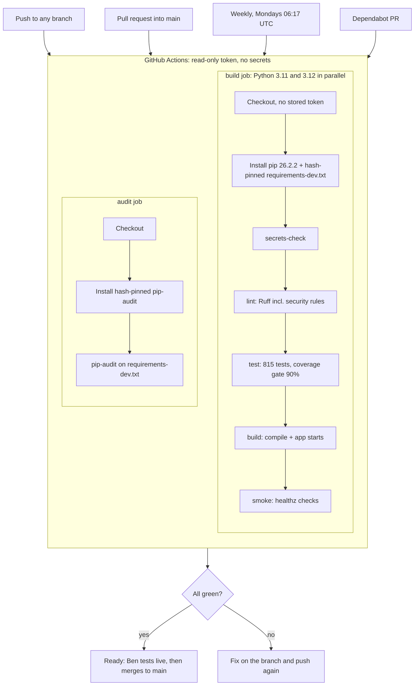

# How the CI pipeline works

CI only: it builds and tests every change. Nothing is deployed or released automatically. Source of truth: `.github/workflows/ci.yml`.

**Text version of the diagram:** four things start CI (a push to any branch, a pull request into main, a weekly schedule, and a Dependabot pull request). CI runs two jobs side by side with a read-only token and no secrets. The build job, once for Python 3.11 and once for 3.12, checks out the code, installs hash-pinned packages, then runs secrets-check, lint, test (with the coverage gate), build and smoke in that order. The audit job installs a hash-pinned pip-audit and checks the pinned dependencies against known vulnerabilities. If everything is green the change is ready for the owner to test live and merge to main; if not, it is fixed on the branch and pushed again.

A failing step stops its job and turns the run red. There is no deploy step; submissions and tags are made by hand.
