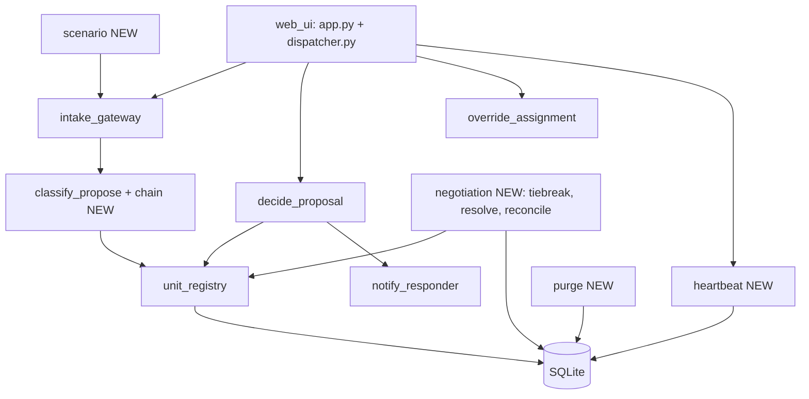

# Reach 90% Verified-Must Implementation Plan

> **For agentic workers:** REQUIRED SUB-SKILL: Use superpowers:subagent-driven-development (recommended) or superpowers:executing-plans to implement this plan task-by-task. Steps use checkbox (`- [ ]`) syntax for tracking.

**Goal:** Raise verified-Must coverage from 16 of 31 (52%) to at least 28 of 31 (90.3%) by Sun 2026-11-08 23:59 Central, where every "verified" is a real passing test (or a recorded manual run), never a softened criterion.

**Architecture:** Keep the modular monolith. Each missing capability becomes one small module under `src/` whose functions take a database connection (and an injected clock where time matters), with pure decision logic (tiebreak, pacing, retry policy) kept separate from storage. New tables only where a criterion needs durable evidence (migrations 0005 to 0007), each raised as a change request. The two criteria that are manual by definition (keyboard-only pass, clean-machine timing) get a recorded-results file the matrix reads.

**Tech Stack:** Python 3.11, Flask (server-rendered HTML, no new runtime dependency), SQLite, pytest, Hypothesis.

**Spec:** `docs/requirements.md` v1.4 (acceptance criteria), `docs/architecture.md` section 5 (interface contracts: Resource/Unit Registry, Resolve Negotiation Conflict, Play Scenario, Purge Job, LLM Generate), `docs/test-plan.md` (signed 2026-11-05).

## Global Constraints

- Heartbeat checked every 10 s; 3 consecutive misses (30 s) trips `NODE_NOT_RESPONDING` (architecture, Resource/Unit Registry).
- Tiebreak order: severity, then information richness, then reported-first; resolution logged as having followed the protocol (FR-COORD-01).
- Fallback order: smaller model, then rules-based, then manual; retry the backup 6 times, once every 10 s for 1 minute; then escalate to a human (FR-DEGRADE-02).
- Purge: rows deleted 24 hours after receipt, except `dispatcher_accounts` and `scenario_runs` (architecture, Purge Job; NFR-PRIV-01).
- Scenario pace: each report arrives after its scenario gap divided by the speed, within 10% (FR-SIM-01-AC2, a hypothesis to be confirmed by this plan's Task 7).
- Every timestamp is ISO 8601 UTC. A reservation returns to available within 4 minutes (existing).
- Tests name the criterion with `@pytest.mark.covers("REQ-ACn")`, open defects are strict xfail with `@pytest.mark.defect`, and `docs/traceability.csv` is generated, never edited.
- Never edit a criterion to fit the build. A criterion that cannot be met stays a visible gap.
- Every task: tests first and seen failing, `./script/lint` and `./script/secrets-check` clean, `./script/test` green with the 90% line-coverage gate, one commit.

## Review Focus

1. A node that resumes heartbeats during a poll must not raise a second alert, and a node that never missed must never raise one (flapping).
2. Two proposals identical on all three tiebreak dimensions (TRUE_TIE) must resolve deterministically, the loser kept as history, never dropped.
3. The purge must be idempotent, run in foreign-key order, and never delete `dispatcher_accounts` or `scenario_runs`, nor a unit's live assignment.
4. A scenario with unsorted, equal or missing timestamps, or a speed of 0 or below, must fail clearly before any report is submitted.
5. When the whole model chain fails, the report must reach a human, never silently disappear.

## Target arithmetic and stop-loss

16 verified now. Gate A (Tasks 1 to 3: MNT-01, SEC-03, PRIV-01) gives 19 (61%). Gate B (Tasks 4 to 7: COORD-01/02/03, SIM-01) gives 23 (74%). Gate C (Tasks 8 to 10: DEGRADE-01, REL-01, DEGRADE-02) gives 26 (84%). Gate D (Tasks 11 to 13: ACC-02, ACC-01) gives **28 (90.3%)**. Task 14 (RES-03, stretch) would give 29. **Left unverified on purpose:** FR-INFER-02 and NFR-PERF-01 (need the RTX target and a real model) and FR-RES-03 AC1 to AC3 unless Task 14 is reached. 28 of 31 has **zero slack**: any single slip is under 90%. If a gate is not reached by its time, stop adding, finish the results honestly, and report the real number; do not move the target.

| Gate | Done by | Verified Musts |
|---|---|---|
| A | Thu night | 19 |
| B | Fri night | 23 |
| C | Sat noon | 26 |
| D | Sat night | 28 |

## Architecture overview

The graph stays acyclic: `negotiation` depends on `unit_registry`, nothing depends on `negotiation` except the route layer and `unit_registry`'s caller in `web_ui`; `heartbeat`, `scenario` and `purge` are leaves.

**Data model changes (each a change request):** 0005 `node_alerts`, `agent_notices`, `human_escalations`; 0006 `tiebreak_log`; 0007 `incident_versions`, `reconciliation_log`. No existing table changes.

## File Structure

- Create `src/negotiation/{__init__,tiebreak,service,reconcile}.py`: pure tiebreak, conflict resolution against the registry, newer-data-wins reconciliation.
- Create `src/heartbeat/{__init__,service}.py`: heartbeat, node polling, alerts, recovery confirmation.
- Create `src/purge/{__init__,job}.py` and `tools/purge.py`: retention purge with a clock override.
- Create `src/scenario/{__init__,reader,cli}.py` and `seed/scenarios/demo-scenario.json`: Scenario Reader.
- Create `src/classify_propose/chain.py`: model fallback chain and retry policy.
- Create `src/web_ui/dispatcher.py`, `src/web_ui/templates/dispatcher.html`, `src/web_ui/static/dispatcher.css`: the keyboard-operable dispatcher console.
- Create `migrations/0005-heartbeat-alerts.sql`, `0006-tiebreak-log.sql`, `0007-incident-versions.sql`.
- Create `tools/check_synthetic.py`, `tools/clean_machine_test.py`, `tools/record_manual_result.py`, `tests/manual/results.csv`, `tests/manual/scripts/*.md`.
- Modify `tools/build_traceability.py` (merge manual results), `src/decide_proposal/service.py` (modify action), `src/unit_registry/service.py` (tiebreak hook), `src/web_ui/app.py` (register blueprint, routes), `docs/test-plan.md` (exit criterion).

## Open decisions for Ben (my recommendation in bold)

- **D1.** Raise the exit criterion in the signed test plan from 60% to 90% verified-Must, recorded as an amendment. **Yes.**
- **D2.** Purge deletes reports, proposals, overrides, follow-ups, notifications, tiebreak and reconciliation logs older than 24 h; it **resets** (does not delete) units and nodes, because deleting the resources breaks the system. **Yes.**
- **D3.** NFR-SEC-03 names `data/synthetic/`; the real data lives in `tests/data/` and `seed/`. **Amend the NFR path (CR-005)** rather than move the data.
- **D4.** "Modify" means a dispatcher approves with a different unit (`final_status = 'modified'`), needed for the four UI actions. **Yes.**
- **D5.** Information richness = total word count of `severity_raw` plus `description`. **Yes, simple and checkable.**
- **D6.** Heartbeat nodes are rows in `agent_nodes` updated by `heartbeat()`; a node that resumes is marked recovered on its alert at once, but the node's own status becomes `recovered` only after a human confirms (the schema forbids `recovered` without a confirmer). **Yes.**
- **D7.** NFR-ACC-01 (mouse unplugged) is a manual pass that **Ben** performs from a written script (about 20 minutes); NFR-MNT-01 is run by the assistant's tool and recorded. **Yes.**
- **D8.** Leave FR-INFER-02, NFR-PERF-01 and (unless Task 14) FR-RES-03 unverified. **Yes, with the reasons written in the results.**

Every task below follows the same five steps unless it says otherwise: (1) write the named failing tests; (2) run them and see them fail; (3) implement the signatures; (4) run the new tests, then `./script/test` (must stay green, gate 90%); (5) commit with a message that says why and names the requirement ids.

---

### Task 0: Foundations: raise the bar, manual-results file, matrix merge

**Files:** Modify `docs/test-plan.md` section 6, `tools/build_traceability.py`; Create `tests/manual/results.csv`, `tools/record_manual_result.py`; Test `tests/unit/test_manual_results.py`.

**Interfaces:** Produces `tests/manual/results.csv` with header `test_id,criteria,level,status,date,tester,evidence`; `tools/record_manual_result.py --id --criteria --status {pass,fail} --tester --evidence PATH` appends a row and refuses a missing evidence file; `build_traceability.build_rows()` also reads that CSV, so a manual row appears like a test row with `level=acceptance`.

- [ ] Tests: `test_a_manual_pass_with_evidence_appears_in_the_matrix`, `test_a_manual_row_without_an_evidence_file_is_refused`, `test_a_manual_fail_is_shown_as_fail_not_pass`, `test_the_exit_criterion_in_the_plan_is_ninety_percent` (reads section 6).
- [ ] Implement as signed above; amend section 6 to "at least 90%" with a dated note that Ben raised it on 2026-11-05.

### Task 1: NFR-MNT-01 clean-machine test

**Files:** Create `tools/clean_machine_test.py`; Test `tests/unit/test_clean_machine_tool.py`; Modify `README.md` only if a step is wrong.

**Interfaces:** `clean_machine_test.run(repo: Path, workdir: Path, runner=subprocess.run, clock=time.monotonic) -> dict` returning `{"seconds": float, "steps": [...], "ok": bool}`; steps are exactly the README's commands (`./script/setup`, `./script/start` then `GET /healthz`); fails if `seconds >= 300`.

- [ ] Tests: `test_the_steps_are_the_readme_steps` (parses the README's Run it block), `test_it_fails_when_setup_takes_five_minutes` (fake clock), `test_it_fails_when_healthz_never_answers` (fake runner).
- [ ] Run once for real against a fresh `git clone` of the current commit; record via `record_manual_result.py` with the output file as evidence, `covers NFR-MNT-01-AC1`.

### Task 2: NFR-SEC-03 synthetic-data check

**Files:** Create `tools/check_synthetic.py`, `docs/change-requests/CR-005-synthetic-data-location.md`; Modify `docs/requirements.md` (NFR-SEC-03 path), `seed/demo-report-*.json` (add `"synthetic": true`); Test `tests/unit/test_check_synthetic.py`.

**Interfaces:** `check_synthetic.violations(root: Path) -> list[str]` returns every report JSON (under `tests/data/` and `seed/`) that lacks `synthetic: true` or sits outside those two folders; the CLI exits 1 if any.

- [ ] Tests: `test_every_committed_report_file_is_marked_synthetic` (the real repo), `test_a_report_file_without_the_marker_is_flagged`, `test_a_report_file_outside_the_allowed_folders_is_flagged` (tmp tree), `test_the_ten_report_spot_check_sample_is_reproducible` (seeded sample of 10 printed for Ben's manual check).
- [ ] Ben does the manual 10-report spot-check once; recorded in `tests/manual/results.csv`.

### Task 3: NFR-PRIV-01 purge job

**Files:** Create `src/purge/job.py`, `tools/purge.py`, migration none; Test `tests/unit/test_purge.py`, `tests/integration/test_purge_privacy.py`; Modify `.github` none.

**Interfaces:** `purge(conn, now: datetime | None = None, retention_hours: int = 24) -> dict[str, int]` deletes, in foreign-key order, notifications, follow-ups, overrides, proposals, then reports older than the window (by `received_at` / `generated_at`), resets units and nodes to available/alive, never touches `dispatcher_accounts` or `scenario_runs`; returns row counts per table.

- [ ] Tests: `test_nothing_newer_than_24_hours_is_deleted`, `test_everything_older_is_deleted_in_foreign_key_order`, `test_dispatcher_accounts_and_scenario_runs_survive`, `test_running_the_purge_twice_changes_nothing_the_second_time`, `test_purge_with_the_clock_overridden_does_not_wait_24_hours`, `test_caller_name_and_phone_are_never_persisted_anywhere` (submit reports whose JSON includes `caller_name` and `caller_phone`; then scan every text column of every table for those strings), `test_after_the_purge_no_row_exists_for_the_seeded_report_ids` (covers NFR-PRIV-01-AC1).
- [ ] Implement; close GitHub issue #2 with a comment.

**Gate A: verified Musts 19.** Run `tools/write_test_results.py`, expect MNT-01, SEC-03, PRIV-01 verified.

### Task 4: Tiebreak as a pure function (COORD-01, COORD-03)

**Files:** Create `src/negotiation/tiebreak.py`; Test `tests/unit/test_tiebreak.py`, `tests/unit/test_tiebreak_properties.py`.

**Interfaces:** `@dataclass(frozen=True) Contender(proposal_id: int, severity: str, richness: int, reported_at: str)`; `@dataclass(frozen=True) Resolution(winner: int, loser: int, reason: str)` with `reason in {"severity", "richness", "reported-first", "true-tie"}`; `richness(severity_raw: str, description: str | None) -> int` (word count, D5); `compare(a: Contender, b: Contender) -> Resolution`; `true-tie` is broken by the lower `proposal_id` so the answer is deterministic.

- [ ] Tests: `test_higher_severity_wins`, `test_equal_severity_more_information_wins`, `test_equal_both_the_earlier_report_wins`, `test_identical_on_all_dimensions_is_a_true_tie_with_a_deterministic_winner`, and property tests: `compare(a, b)` and `compare(b, a)` name the same winner; the result is transitive over three contenders (Hypothesis, fixed seed).

### Task 5: Conflict resolution against the registry (COORD-01, COORD-03)

**Files:** Create `src/negotiation/service.py`, `migrations/0006-tiebreak-log.sql`, `docs/change-requests/CR-006-tiebreak-log.md`; Modify `src/unit_registry/service.py` (call the hook when a reservation held by an undecided proposal is contested); Test `tests/unit/test_negotiation.py`, `tests/integration/test_negotiation_http.py`, `tests/acceptance/test_acceptance_negotiation.py`.

**Interfaces:** Consumes Task 4. Produces `resolve_conflict(conn, proposal_a: int, proposal_b: int, now=None) -> dict` returning `{"winner", "loser", "reason", "resolved_at"}` and writing a `tiebreak_log` row `(id, winner_proposal_id, loser_proposal_id, reason, protocol_followed INTEGER, resolved_at)`; resolving the same pair twice returns the same result without a second row; `requeue_loser(conn, loser_proposal_id: int, contested_unit_id: int) -> dict` finds the next best available unit via `reserve_for_proposal`, excluding the contested one.

- [ ] Tests: `test_two_proposals_for_the_same_unit_are_resolved_by_severity_first` (covers FR-COORD-01-AC1), `test_the_loser_gets_the_next_best_available_unit` (AC2), `test_the_resolution_is_logged_as_following_the_protocol`, `test_resolving_the_same_pair_twice_gives_the_same_winner_and_one_log_row`, `test_a_true_tie_keeps_the_loser_as_history_not_discarded` (covers FR-COORD-03-AC2), `test_a_conflict_that_is_not_a_unit_claim_uses_the_same_order` (covers FR-COORD-03-AC1).
- [ ] A contested reservation held by an *assigned* unit is never taken: add `test_an_assigned_unit_is_never_taken_by_a_tiebreak`.

### Task 6: Reconciliation of differing pictures (COORD-02)

**Files:** Create `src/negotiation/reconcile.py`, `migrations/0007-incident-versions.sql`, `docs/change-requests/CR-007-incident-versions.md`; Test `tests/unit/test_reconcile.py`, `tests/integration/test_reconcile_http.py`.

**Interfaces:** `record_version(conn, report_id: int, agent_node_id: int, data: dict, data_timestamp: str) -> int`; `reconcile(conn, report_id: int, now=None) -> dict` makes the newest `data_timestamp` the active version and keeps older ones as history (`active = 0`, never deleted); `override_reconciliation(conn, report_id: int, version_id: int, reason: str, dispatcher_id: int) -> dict` writes a `reconciliation_log` row `(who, when, original automatic version, chosen version, reason)` and refuses an empty reason; route `POST /reconciliations/<report_id>/override`.

- [ ] Tests: `test_the_newer_data_becomes_active_and_the_older_is_kept_as_history` (covers FR-COORD-02-AC1), `test_equal_timestamps_resolve_deterministically`, `test_a_human_override_is_logged_with_who_when_and_the_original_automatic_decision` (covers AC2), `test_an_override_without_a_reason_is_refused`, `test_history_is_never_deleted`.

### Task 7: Scenario Reader (SIM-01)

**Files:** Create `src/scenario/{reader,cli}.py`, `seed/scenarios/demo-scenario.json`; Modify `docs/requirements.md` FR-SIM-01-AC2 only if Ben changes the hypothesis; Test `tests/unit/test_scenario_reader.py`, `tests/integration/test_scenario_http.py`.

**Interfaces:** `load_scenario(path: Path) -> list[ScenarioReport]` (`ScenarioReport(reported_at: datetime, payload: dict)`), raises `ScenarioFileInvalid` for malformed JSON, missing times, unsorted times, or a non-list; `play_scenario(path: Path, speed: float, submit: Callable[[dict], Any], sleep=time.sleep, clock=time.monotonic) -> dict` returning `{"run_id", "reports_queued", "started_at", "gaps": [seconds...]}`, inserts a `scenario_runs` row, sleeps `gap / speed` between reports, raises `ValueError` if `speed <= 0`; CLI `python -m src.scenario.cli FILE --speed N`.

- [ ] Tests: `test_reports_sixty_seconds_apart_arrive_six_seconds_apart_at_ten_times_speed` (within 10%), `test_the_same_scenario_at_the_same_speed_repeats_order_and_spacing` (covers FR-SIM-01-AC2), `test_a_malformed_scenario_fails_before_any_report_is_submitted`, `test_speed_zero_or_negative_is_refused`, `test_each_play_gets_its_own_run_id`; the existing FR-SIM-01-AC1 test already passes.
- [ ] Ben confirms or edits the hypothesis wording once the tests describe it.

**Gate B: verified Musts 23.**

### Task 8: Heartbeats, alerts, recovery (DEGRADE-01)

**Files:** Create `src/heartbeat/service.py`, `migrations/0005-heartbeat-alerts.sql`, `docs/change-requests/CR-008-heartbeat-alerts.md`; Test `tests/unit/test_heartbeat.py`, `tests/integration/test_heartbeat_http.py`.

**Interfaces:** `heartbeat(conn, node_id: int, now=None) -> dict` updates `agent_nodes.last_heartbeat_at`; `check_nodes(conn, now=None, interval_s: int = 10, misses: int = 3) -> list[dict]` flags every `alive` node silent for `interval_s * misses` seconds as `not_responding`, writes one `node_alerts` row, one `agent_notices` row per other alive node, and is idempotent (no second alert); `resume(conn, node_id: int, now=None)` sets `node_alerts.recovered_at` (late recovery); `confirm_recovery(conn, node_id: int, dispatcher_id: int) -> dict` is the only way the node's status becomes `recovered` (schema invariant); route `POST /nodes/<id>/confirm-recovery` and `GET /alerts`.

- [ ] Tests: `test_a_node_silent_for_thirty_seconds_is_flagged_and_other_agents_and_a_human_are_notified` (FR-DEGRADE-01-AC1), `test_a_node_silent_for_twenty_nine_seconds_is_not_flagged`, `test_a_second_poll_does_not_raise_a_second_alert`, `test_a_node_that_resumes_gets_its_alert_marked_as_a_late_recovery` (AC2), `test_the_node_is_only_recovered_after_a_human_confirms`, `test_a_node_that_never_missed_never_alerts`.

### Task 9: Real-process detection time (NFR-REL-01)

**Files:** Create `tools/measure_heartbeat.py`; Test `tests/integration/test_node_failure_detection.py` (marked slow, still part of `./script/test`).

**Interfaces:** `measure_trials(trials: int = 5, interval_s: int = 10, misses: int = 3) -> list[float]` starts `trials` real child processes that call `heartbeat()` every `interval_s`, kills them together, polls `check_nodes` once a second, and returns each kill-to-alert latency in seconds.

- [ ] Test: `test_five_killed_node_processes_are_each_detected_within_thirty_seconds` (covers NFR-REL-01-AC1; about 45 s). Record the five times in `docs/measurements.md`.

### Task 10: Model fallback chain (DEGRADE-02)

**Files:** Create `src/classify_propose/chain.py`; Modify `src/classify_propose/service.py` and `src/web_ui/app.py` (use the chain), `migrations/0005` (`human_escalations`); Test `tests/unit/test_model_chain.py`.

**Interfaces:** `@dataclass RetryPolicy(attempts: int = 6, every_seconds: float = 10.0)`; `class ModelChain(primary, smaller, rules, retry: RetryPolicy = RetryPolicy(), sleep=time.sleep)` with `classify(report: dict) -> dict` that tries primary, then smaller, then rules; when every model fails it retries the backup per the policy, then raises `ChainExhausted`, and the caller writes a `human_escalations` row and returns `needs_human` with code `MODEL_CHAIN_EXHAUSTED`.

- [ ] Tests: `test_a_failing_primary_falls_back_to_the_smaller_model_then_rules` (AC1), `test_a_chain_that_fails_everywhere_retries_six_times_ten_seconds_apart_then_escalates` (fake sleep records `[10.0] * 6`), `test_the_escalation_reaches_a_human_never_silence`, `test_a_recovering_backup_stops_the_retries`.

**Gate C: verified Musts 26.**

### Task 11: The modify action

**Files:** Modify `src/decide_proposal/service.py` (`decide_human`), `src/web_ui/app.py`; Test `tests/unit/test_human_modify.py`, `tests/integration/test_modify_http.py`.

**Interfaces:** `decide_human(conn, proposal_id, decision, dispatcher_id, now=None, modified_unit_id: int | None = None)` accepts `"modify"` (requires `modified_unit_id`, which must be available), sets `final_status = 'modified'`, releases the original unit, assigns the new one in one transaction; errors `MODIFIED_UNIT_REQUIRED`, `UNIT_ALREADY_RESERVED`.

- [ ] Tests: `test_modify_assigns_the_chosen_unit_and_frees_the_original`, `test_modify_without_a_unit_is_refused`, `test_modify_to_a_taken_unit_changes_nothing`, `test_the_database_rule_allows_a_modified_proposal_to_hold_an_assigned_unit`.

### Task 12: Dispatcher console (ACC-02, and the UI for ACC-01)

**Files:** Create `src/web_ui/dispatcher.py`, `templates/dispatcher.html`, `static/dispatcher.css`; Modify `src/web_ui/app.py` (register); Test `tests/integration/test_dispatcher_ui_http.py`, `tests/unit/test_dispatcher_accessibility.py`.

**Interfaces:** `GET /dispatcher` renders the pending queue, unit clock, alerts, and, for each proposal, four `<form method="post">` actions (approve, modify, reject, override) using native `<button>` and `<label>`-ed inputs, a visible `:focus` outline, severity shown as text plus a distinct symbol, no color-only meaning, no `tabindex` above 0.

- [ ] Tests: `test_every_interactive_element_is_a_native_labelled_control`, `test_focus_is_visible_in_the_stylesheet`, `test_text_and_background_contrast_is_at_least_4_5_to_1`, `test_five_incidents_one_per_level_are_each_named_in_text_without_colour` (covers NFR-ACC-02-AC1, with colour stripped), `test_all_four_actions_work_through_the_page_forms`.

### Task 13: Keyboard-only pass (ACC-01)

**Files:** Create `tests/manual/scripts/acc-01-keyboard-only.md`; Modify `tests/manual/results.csv` (a recorded row).

- [ ] Write the numbered script (open `/dispatcher`, Tab to a proposal, approve; repeat for modify, reject, override; expected: focus visible after every key press). **Ben runs it with the mouse unplugged** and records the result with `tools/record_manual_result.py --id ACC-01 --criteria NFR-ACC-01-AC1 --status pass --tester Ben --evidence <screen recording or notes file>`.

**Gate D: verified Musts 28 (90.3%).**

### Task 14 (stretch): Agent status broadcast (RES-03)

**Files:** Create `src/unit_registry/broadcast.py`, migration 0008 (`unit_events`, `agent_inboxes`); Test `tests/unit/test_broadcast.py`.

**Interfaces:** `publish(conn, unit_id, status, proposal_id, at)` writes a `unit_events` row and one `agent_inboxes` row per other agent node (cached if the node is `not_responding`, with a warning notice); `agent_view(conn, node_id) -> dict[int, str]` is that agent's picture of unit statuses.

- [ ] Tests: `test_every_agent_sees_a_status_change` (AC1), `test_an_update_for_a_down_node_is_cached_and_a_warning_is_raised` (AC2), `test_a_reservation_is_timestamped_and_excluded_from_other_agents_choices` (AC3). Reaching this gives 29 of 31 (93.5%), one unit of slack.

### Task 15: Final run

- [ ] Run `tools/verify_regression.py`, `tools/write_test_results.py`; update `docs/defect-log.md` with any new defects found along the way (each with all seven fields and a named regression test); push; confirm CI green; make the last commit with the exact message `milestone 11: test plan, suite, results, defect log`; update `docs/ai-usage.md` and the weekly status block.

## Self-review

- **Spec coverage:** COORD-01/03 (Tasks 4, 5), COORD-02 (6), SIM-01 (7), DEGRADE-01 (8), REL-01 (9), DEGRADE-02 (10), ACC-02 (12), ACC-01 (11 to 13), PRIV-01 (3), SEC-03 (2), MNT-01 (1), RES-03 (14, stretch); FR-INFER-02 and NFR-PERF-01 intentionally unbuilt (hardware), written into the results.
- **Type consistency:** `Contender`/`Resolution` (Task 4) are what Task 5 consumes; `decide_human(..., modified_unit_id)` (Task 11) is what Task 12's forms call; `heartbeat`/`check_nodes` (Task 8) are what Task 9 measures.
- **Review Focus:** each of the five has a named test (flapping: Task 8; true tie: Task 4/5; purge idempotency and survivors: Task 3; bad scenarios: Task 7; chain exhaustion reaches a human: Task 10).
- **Proportion:** interfaces and test names only; no function bodies.
